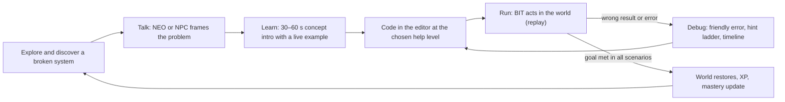
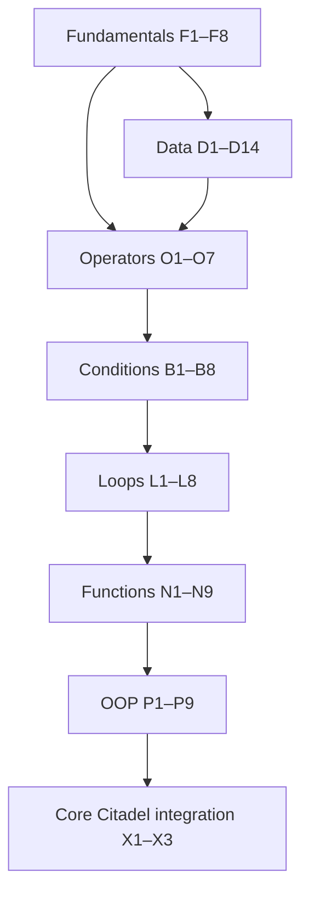
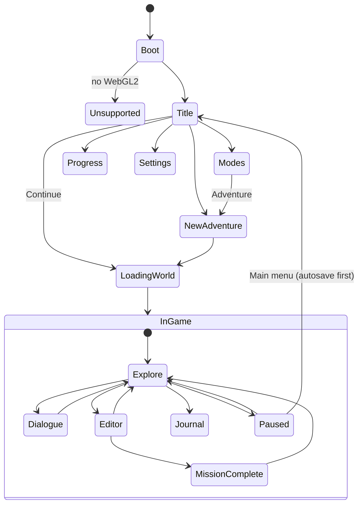
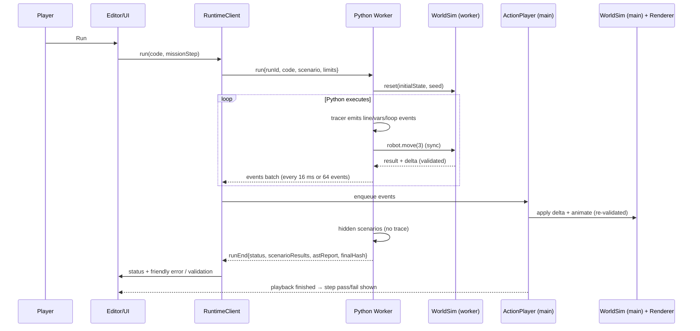
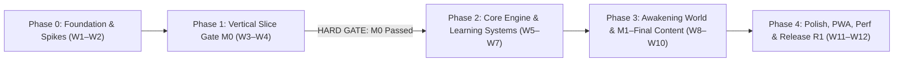
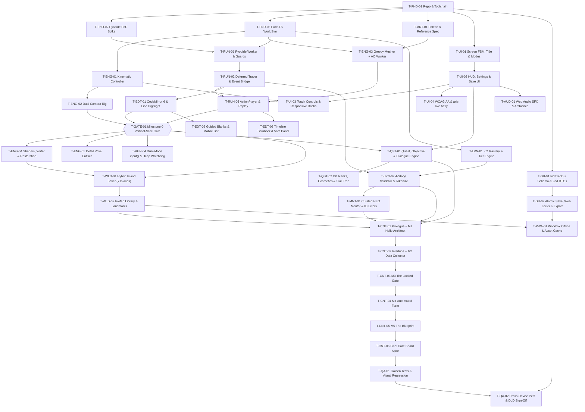

# PYCRAFT — Master Implementation Plan
### "Code Your World." · Planning deliverable v1.0 · 2026-11-12

> [!IMPORTANT]
> This is a planning document only. The repository has not been modified, no dependencies were installed and no application code was written. Performance numbers below are **targets**, not measurements.

---

## What I understood about PYCRAFT

PYCRAFT is a **3D voxel adventure game that runs in the browser**. Writing real Python is how the player changes the world. The player is an **Architect** who wakes up in **Aetheria**, a group of floating islands. The world's machines stopped working when the ancient **Code Core** failed. With **NEO** (a companion robot who teaches) and a small builder robot they program, the player writes real Python (run by Pyodide in a Web Worker). That code moves robots, opens gates, plants farms and builds structures, and the results animate in the world. The game teaches beginners (ages 13–18, plus casual learners) from `print()` all the way to OOP. The player learns because they want to fix something in the game, not because a lesson tells them to. The first release is one polished region, **The Awakening**. It must play well on desktop and on mobile (both portrait and landscape), save locally to IndexedDB, and look like an art-directed indie game rather than a "gamified course" website.

---

## 1. Executive Summary

**What we build first (Release R1 = MVP):** a polished, complete Adventure Mode slice. It has a main menu that shows the live 3D world, three local save slots, The Awakening region (7 floating islands), the player, NEO, BIT (the robot you program), BOLT and two villagers, five learning missions plus a final Code Core challenge, real Python execution with execution visualization, a learning engine that adapts the level of help, a curated (non-AI) NEO mentor, XP, ranks and cosmetics, and IndexedDB saves with migrations, backups and export/import. It works with mouse and keyboard and with touch.

**The central technical bet (locked):** *simulate in the worker, replay on the main thread.*
Player code runs inside Pyodide in a dedicated Web Worker, against a deterministic TypeScript world simulation that lives in that same worker. Robot commands run synchronously against that simulation, so commands like `robot.front()` return real values right away, and loops and conditions work with no special handling. The worker streams a recorded event log (lines, variable changes, stdout, world actions with state changes) to the main thread. There, an **Action Player** animates the events at a speed the player chooses, and the rendering thread is never blocked. The main thread re-applies every action through its own copy of the same simulation, so it stays authoritative over world state. `input()` blocks for real through `SharedArrayBuffer` + `Atomics` when the page is cross-origin isolated. Otherwise it falls back to a list of answers the player fills in before running.

**Stack (locked):** Vite + React 19 + TypeScript (strict) · Three.js via React Three Fiber (only a few Drei helpers) · a custom voxel mesher and kinematic character controller (**no Rapier in MVP**) · Pyodide (self-hosted, pinned) in a Web Worker · CodeMirror 6 · Zustand · IndexedDB through `idb` with `zod` validation · Cloudflare Pages (+ Pages Functions later, for the AI proxy) · Vitest + Playwright.

### 1.1 Decision ledger

| Type | Item |
|---|---|
| **Locked decisions** | Greenfield Vite/React/TS app with npm in one package · R3F as the scene layer, but per-frame game logic in plain TypeScript systems (no React state updated per frame) · custom voxel engine (greedy meshing, baked vertex AO, color jitter in the shader) · two voxel scales only: **World voxel = 1.0 unit**, **Detail voxel = 0.125 unit** · no pixel textures (vertex colors from a locked palette) · no bloom, SSAO or lens effects · fixed late-morning time of day · simulate in the worker / replay on main · each run starts from the puzzle's initial state · conditional missions validated against several hidden scenarios · capability allowlist per mission · 3 save slots · global settings · UI language Bahasa Indonesia (default) + English; Python API identifiers in English · region unlock = previous region's Core challenge completed (mastery sets the level of help, never gates progress) · the title screen renders the real Awakening world (smooth hand-off into gameplay) · in-world dialogue camera instead of 2D portraits · Cloudflare Pages hosting with COOP/COEP headers |
| **Reasonable assumptions** | Indonesian is the main audience language (the brief asks for Indonesian error explanations) · the target is browsers released in the last ~3 years with WebGL2 · players have a connection for the first load (offline after that through the PWA cache) · MVP playtime is about 2–3 h (to be checked in playtests) · the implementer has no 3D artist, so all art comes from code and data (prefab JSON + an island generator), which is why the art bible is strict and enforced by lint |
| **External dependencies** | **The reference image was not found** in the message attachments or in `D:\Pycraft`. The art direction below is based on the written brief, and task T-ART-00 checks it against the image once the image is placed at `docs/art/reference.*` · Cloudflare account (hosting, later AI proxy and rate limiting) · an AI provider account and API key (R2) · CC0 or licensed sound effects and 2 music tracks · OFL fonts (Atkinson Hyperlegible Next, Barlow Semi Condensed, JetBrains Mono) · real test devices · 5–8 playtesters aged 13–18 (with guardian consent) |
| **Deferred functionality** | Remote LLM mentor (R2, the interface ships in R1) · key rebinding · gamepad · regions 2–8 · Automation, Creative Sandbox and Challenge modes (shown as "Segera Hadir", not playable) · cloud saves and accounts · teacher dashboard · WebGPU renderer · `.vox` import tooling |

---

## 2. Product Understanding and Design Principles

1. **Code is the verb.** Every coding task changes something you can see in the world. If a concept has no world effect, it is taught through an in-world device (rune pillars, signboards, the Beacon terminal), never through a bare quiz.
2. **Want first, learn second.** Each mission opens with a problem in the world (a dark beacon, a missing bridge, a locked gate) before NEO introduces the concept.
3. **Honest feedback.** The world shows exactly what the code did. A wrong program gives a visible, readable result (BIT bumps into a rock) instead of a silent failure.
4. **Help adapts to the person, not to the level number.** The amount of help follows measured performance, and the learner can always choose more or less help.
5. **No shame, no manipulation.** Hints never reduce base XP. There are no streaks, timers, loot boxes or push notifications, and nothing is lost by stepping away.
6. **Restraint is the art style.** A locked palette, two voxel scales, one sun, baked AO and minimal UI. Effects never stand in for composition.
7. **Mobile is first-class.** Every essential action works by touch in both portrait and landscape.
8. **Local-first and safe.** No account, saves stay on the device, failures are reported clearly, and the player's code is isolated in a worker.
9. **Build only what R1 needs, with seams for later.** Runtime, learning engine, saves and rendering are shared modules so future modes can reuse them, but nothing is built for those modes before they are needed.

---

## 3. Repository and Existing Stack Assessment

| Check | Finding (inspected 2026-11-12 21:02 local) |
|---|---|
| `D:\Pycraft` contents | **Empty directory** (created 2026-11-12 21:00:55). No source, config or assets. |
| Version control | **Not a git repository.** |
| Node.js / npm | v24.14.1 / 11.11.0 available |
| pnpm | Not installed |
| Host Python | 3.13.12 (useful for authoring scripts; **not** the game runtime) |
| Reference image | **Not present** in the workspace or the conversation |

**Conclusion:** this is a greenfield project, so there is no existing stack to keep. The stack is chosen on merit (Section 13). We use **npm** (already installed) rather than adding pnpm. A single package is enough for one web app plus a small `functions/` directory, and module boundaries are enforced by lint rules instead of a monorepo. The first task (T-00-01) runs `git init` and sets up the toolchain.

---

## 4. Product Scope and Explicit Non-Goals

**Priority meaning:** **P0** = must have for MVP Definition of Done · **P1** = in MVP scope and part of DoD unless explicitly descoped in writing · **P2** = only if time allows in the MVP window, otherwise R2.
**Release meaning:** **R1 MVP** (The Awakening) · **R2 Next** (Data Valley + Arithmetic Mines, remote AI mentor, rebinding) · **R3+ Future**.

| # | Feature from brief | Class | Priority / notes |
|---|---|---|---|
| 1 | Immersive start screen (live 3D world) | R1 | P0 |
| 2 | Continue / New Adventure with overwrite protection | R1 | P0 |
| 3 | Game Modes screen (Adventure available; 3 marked "Segera Hadir") | R1 | P0; future modes are non-interactive cards |
| 4 | World / Progress screen (regions, missions, learning) | R1 | P1 |
| 5 | Settings: audio, graphics, controls (view + sensitivity/invert), language, accessibility, save management | R1 | P0 (key rebinding → R2) |
| 6 | Fullscreen toggle (user-initiated) | R1 | P0 |
| 7 | PWA install + offline after first load | R1 | P1 |
| 8 | Awakening region (7 islands) | R1 | P0 |
| 9 | Regions 2–8 | R2 (2, 3), R3 (4–6), R4 (7, 8) | Visible on the world map as locked |
| 10 | Third-person + isometric cameras with transitions | R1 | P0 |
| 11 | Walk / jump / interact / collect resources | R1 | P0 |
| 12 | Desktop controls (WASD, mouse, scroll, keys) | R1 | P0 |
| 13 | Touch controls (joystick, contextual buttons, camera drag, pinch) | R1 | P0 |
| 14 | Gamepad | R3 | — |
| 15 | NEO, BIT, BOLT + villagers (Mira, Tamo) | R1 | P0 |
| 16 | The Guardian | R1 cameo (silhouette + voice text); full role R4 | — |
| 17 | Quest/objective system, dialogue | R1 | P0 |
| 18 | Real Python (Pyodide) in a worker + Game API | R1 | P0 |
| 19 | 5 missions + final Core challenge | R1 | P0 |
| 20 | Code editor (highlighting, autocomplete, line numbers, run/stop, console, reset, examples, hints) | R1 | P0 (autocomplete P1) |
| 21 | Visualization: line highlight, status, play/pause/stop, speed, step forward | R1 | P0 |
| 22 | Visualization: variable panel, loop counters, scrub/rewind | R1 | P1 |
| 23 | Function call stack view | R3 (Function Kingdom) | Trace already records call/return events |
| 24 | Learning engine: 4 assistance levels, mastery, adaptive offers | R1 | P0 (Mastery tier = optional bonus) |
| 25 | XP, ranks, skill tree, cosmetics, BIT customization, restoration | R1 | P0 (skill tree P1) |
| 26 | Curated NEO mentor (explain, error translation, hint ladder, Socratic prompts) | R1 | P0 |
| 27 | Remote LLM mentor through server proxy, limits, moderation | R2 | Interface and context builder in R1 |
| 28 | IndexedDB saves (all listed data), migrations, backups, status | R1 | P0 |
| 29 | Save export/import (JSON + checksum) | R1 | P1 |
| 30 | Multi-tab write protection (Web Locks) | R1 | P1 |
| 31 | Scratchpad (console-only Python anywhere) | R1 | P2 |
| 32 | Automation Mode / Creative Sandbox / Challenge Mode | R3+ | Not playable in R1 |
| 33 | Audio (SFX, 2 music tracks, ambience) | R1 | P1 |
| 34 | Adaptive graphics quality + FPS overlay | R1 | P0 |
| 35 | Lore notes (side collectibles, e.g. "What is Python") | R1 | P2 |

**Explicit non-goals for R1:** multiplayer or social features · accounts, cloud sync, any remote database · leaderboards · monetization · voice acting · procedurally generated infinite worlds · free-form AI chat · native app stores · a WebGPU renderer · user-generated content sharing · teacher/classroom dashboards · Python packages beyond the standard library (no `micropip`) · day/night cycle · combat.


---

## 5. Game Design Document

### 5.1 Identity
- **Genre:** third-person exploration and puzzle adventure where programming the robot is the main puzzle mechanic.
- **Fantasy:** "I am an Architect. My words (Python) bring machines and the world back to life."
- **Session shape:** missions take about 15–30 min each, with checkpoints after every step so a 5-minute mobile session still makes progress.
- **Fail states:** none that punish the player. Falling off an island fades out and respawns you at the last safe ground position. A bad program gives a visible result and an explanation, never a "game over".

### 5.2 Player verbs

| Verb | Desktop | Touch | Notes |
|---|---|---|---|
| Move | WASD / arrows | Left-side floating joystick | Walking speed 4.0 u/s; sprint ×1.6 (Shift / push joystick past 90%) |
| Jump | Space | Jump button | Apex 1.3 u, so the player can climb a 1-block step and never a 2-block one |
| Camera orbit | Hold RMB or LMB-drag on the world | One-finger drag on the right side | Optional pointer lock in settings |
| Zoom | Scroll | Pinch | Third-person distance 3–9 u; iso zoom 0.6×–1.6× |
| Interact / talk / collect | E | Contextual button with icon + label | Appears within 2.0 u of an interactable, with a highlight frame |
| Camera mode toggle | V | Camera button | Auto-switches to iso in puzzle zones (setting) |
| Iso rotate 90° | Z / C | Two-finger twist or ⟲⟳ buttons in iso mode | |
| Open editor | Tab | `</>` button | Allowed anywhere; Run needs a mission context (or Scratchpad, P2) |
| Run / Stop | Ctrl/Cmd+Enter / Ctrl+. | ▶ / ■ in editor | |
| Journal (quests, inventory, skills, profile) | J / I / K | Journal button in pause menu and HUD | |
| Map | M | Pause → Map | |
| Pause | Esc / P | ☰ button | Esc first closes the topmost panel |

While a text field or the editor has focus, the game ignores keyboard input. The editor never "steals" WASD and the game never steals typing.

### 5.3 Systems overview

| System | Responsibility | R1 |
|---|---|---|
| Exploration | Character controller, voxel collision, cameras, interactables | ✓ |
| Puzzle zones | Bounded grid areas where BIT runs code; they own a puzzle simulation | ✓ |
| Code runtime | Pyodide worker, Game API, tracing, limits | ✓ |
| Action playback | Animates the recorded event stream, timeline | ✓ |
| Quests and dialogue | Data-driven quest graph, dialogue trees, objective tracker | ✓ |
| Learning engine | Concepts, mastery, choosing the help level, validators | ✓ |
| Mentor | Curated hint ladder, error translation, concept cards (provider interface) | ✓ (curated) |
| Progression | XP, ranks, unlocks, cosmetics, restoration flags | ✓ |
| Inventory | Player items and resources; BIT's per-mission cargo | ✓ |
| Persistence | IndexedDB slots, autosave, backups | ✓ |
| Audio | SFX, music, ambience, ducking | ✓ |

### 5.4 Economy and rewards (no grinding)
- **XP** comes only from learning work: completing mission steps, bonus challenges and lore notes. You cannot farm it by repeating content (each step pays out once).
- **Ranks** (Indonesian / English): 1 Perintis / Initiate (0) · 2 Magang / Apprentice (250) · 3 Pembangun / Builder (600) · 4 Insinyur / Engineer (1,200) · 5 Perajin / Artisan (2,200) · 6 Ahli / Master (3,600) · 7 Arsitek Agung / Grand Architect (5,500). R1 offers about 1,650 XP, so a full playthrough reaches **Engineer**.
- **Cosmetics** are unlocked by milestones, never sold: BIT paint (Moss, Clay, Slate, Sky), BIT accessories (Lantern, Antenna Flag), NEO visor tints (Turquoise, Amber), Architect scarf colors.
- **Restoration:** each completed mission visibly heals part of the region (Section 6.3). This is the main reward.

---

## 6. World and Narrative Design

### 6.1 Premise
Long ago the Architects wrote the **Code Core**, a lattice of instructions that kept Aetheria's islands afloat and its machines running. The Core cracked during the **Silence**. Machines forgot their instructions, beacons went dark, rivers stalled and bridges fell. The player wakes in a stasis shrine as the last Architect. Their memory of the old language is empty, and NEO's memory is fragmented. **They relearn Python together.** This is why NEO teaches as a fellow rediscoverer and not as a lecturer.

### 6.2 Aetheria layout (all regions)
The islands form a **rising spiral around the Core Citadel**, a huge cracked stone monolith with turquoise veins that floats at the center and above everything. It can be seen from every region, so players always know where the story ends. Each restored region rebuilds a **Skybridge** to the next one.


| # | Region | Theme and environmental storytelling | Landmarks | NPCs | Concepts | Unlock |
|---|---|---|---|---|---|---|
| 1 | **The Awakening** | Gentle grassy islands with Architect ruins. Dormant beacons, a dry waterfall and a collapsed bridge show that the Silence happened recently. | Stasis Shrine, Beacon Point, Supply Grove, Gatehouse, Terrace Farm & waterfall, BOLT's Workshop, Core Shard Spire | NEO, BIT, BOLT, Mira (farmer), Old Tamo (gatekeeper), Guardian (vision) | Fundamentals + first taste of variables, conditions, loops, functions | New game |
| 2 | **Data Valley** | A broad river valley with stone archive terraces. Crystals lie scattered and unsorted, cataloguing automatons hold mislabeled crates. | The Great Archive, Crystal Shelves, River Index Mill | Archivist Sela, cataloguer bots | Data types, strings, lists, tuples, sets, dicts, objects intro | Awakening Core Shard |
| 3 | **Arithmetic Mines** | Underneath a massive island: shafts carved into the stone layer, warm lamps, mine-cart rails. Lifts are stuck because their counterweights were miscalculated. | Counterweight Lift, Ore Splitter, Deep Furnace | Foreman Rukun, miner bots | Arithmetic, assignment, precedence, `math` | Data Valley Core |
| 4 | **Logic Fortress** | A walled fortress on a cliff island. Guard automatons are frozen at gates, unable to decide. Banners show rival rules. | Three-Banner Gate, Rune Hall, Inner Keep | Captain Varo, guard automatons | Comparison, logic, if/elif/else, nesting, truthiness | Mines Core |
| 5 | **Automation Forest** | A deep forest overgrowing BOLT's old sawmills, with idle water wheels and stopped conveyors. | Great Sawmill, Seed Nursery, Pressure Tower | **BOLT** (hub), lumber bots | for, while, range, break/continue, nested loops | Fortress Core |
| 6 | **Function Kingdom** | A guild town whose blueprint library burned. Citizens rebuild by hand, over and over. | Blueprint Library, Guild Halls, Castle Walls | Queen Ilsa, guild masters | def, params/args, return, scope, nested functions, modules, try/except | Forest Core |
| 7 | **Object Realm** | An ancient bronze robot foundry with robot "families" sorted by lineage. | Foundry, Hall of Lineage, Sealed Vault | Forgemaster Odo, robot families | Classes, objects, methods, `__init__`, inheritance, encapsulation, polymorphism | Kingdom Core |
| 8 | **Core Citadel** | The monolith itself, inside the Code Core lattice. | Guardian's Hall, Trial Platforms, Core Heart | **THE GUARDIAN**, NEO, BOLT | Integration capstone | Object Realm Core |

### 6.3 The Awakening — detailed design (R1)
**Footprint:** about 160 × 160 units across X and Z, with heights from −40 (island undersides) to +45 (spire top). There are seven islands. Distant regions show up as low-detail silhouettes in the haze.


| Island | Composition and storytelling | Interactables | Dormant → Restored |
|---|---|---|---|
| **A Stasis Shrine** | A small round island. The player wakes in a cracked stone pod. NEO lies dormant on a pedestal. Teaches movement by moving the player along the path. | Pod, NEO pedestal (reboot), lore note | Gray-olive grass → fresh grass and a few flowers |
| **B Beacon Point** | A cliff edge with an old stone beacon and a terminal facing the sea of sky. | Beacon Terminal (code), signpost | Dark beacon → warm amber lamp; signpost shows player text |
| **C Supply Grove** | A wooded island with scattered crates and blue crystal clusters. BIT lies switched off under a tree, with BOLT's note. | 3 crystals (manual collection), BIT, crates, bridge anchor | Bridge gap → plank bridge |
| **D Gatehouse Rock** | Fortified rock. A double gate with rune pillars, a crystal sensor and a weight scale. Old Tamo waits on a bench. | Rune pillars, sensor, scale, gate | Red-sealed gate → open; rune pillars lit |
| **E Terrace Farm** | Three-level terraces fed by a dry waterfall, a stalled water wheel and empty fields. Mira's house. | Farm rows, water wheel, lift | Still pond → flowing turquoise waterfall, growing crops, turning wheel |
| **F BOLT's Workshop** | Workshop with a crane, block depot and an unfinished watchtower foundation. | Depot, blueprint table, tower site | Foundation → finished watchtower with stairs |
| **G Core Shard Spire** | The highest island. A cracked shard on an altar, with energy-cell sockets. | Cells, altar, stairs zone | Cracked, dim veins → restored shard; Guardian vision; distant Skybridge appears |

**Restoration rendering:** each island zone has a `restoration` uniform (0 → 1) that blends between a dormant and a restored palette per material class, toggles prop sets (flowers, crops, water), and turns on water flow. The state comes from quest flags, so no voxel data needs to be saved.

### 6.4 Characters

| Character | Role and personality | Visual spec (Detail voxels, 0.125 u) | Voice and dialogue rules |
|---|---|---|---|
| **Architect** (player) | The player's silent avatar. A capable newcomer. | 14 voxels tall (1.75 u). Chunky proportions (head 4×4×4). Customizable: 6 skin tones, 4 hair styles, 6 hair colors, 6 scarf/outfit accent colors. Neutral work clothes in muted canvas and brown leather. | Has no lines. The player picks short replies (2–3 options) |
| **NEO** | Companion and teacher. Curious, warm, lightly dry humor. Admits gaps ("Memoriku tentang ini masih rusak — ayo kita uji"). Never condescending. | Floating drone, about 0.6 u. Off-white ceramic shell, a turquoise visor bar showing 8 eye shapes (neutral, happy, thinking, surprised, concerned, focused, proud, sleepy), brass trim, a short antenna. Bobs 4 cm over a 2.4 s cycle. | Each bubble is at most 140 characters. Every 2–4 lines ends with a question or action. Explains with one concrete in-world example first and the term second |
| **BIT** | The robot you program. Earnest and slightly clumsy. | 1×1 u footprint, 0.8 u tall. Moss-green body, brass treads, a front scanner lens, a small crane arm. Paint is customizable. | Does not speak. Beeps and tilts its lens; `robot.say()` shows speech bubbles |
| **BOLT** | Engineer and automation enthusiast. Fast-talking, practical, hates manual repetition. | Stocky adult human, 15 voxels tall. Leather apron, copper goggles, rolled sleeves, tool belt, gray-streaked beard. | Short, energetic lines with workshop metaphors ("Kenapa ulang 100 kali kalau bisa tulis loop?") |
| **Mira** | Farmer. Patient and practical. | 14 voxels. Straw hat, olive dress, basket. | Grounded farming language |
| **Old Tamo** | Gatekeeper and historian. Slow-spoken and fond of riddles. | 13 voxels. Hunched, blue-gray robe, staff. | Short lines; introduces True/False as "rune truths" |
| **THE GUARDIAN** | Ancient keeper of the Core. Formal, solemn, fair. | Huge stone and bronze colossus built from World voxels, turquoise veins (not glowing). R1 shows it only as a distant silhouette in a vision. | Speaks in formal Indonesian; 3 lines in R1 |

### 6.5 Narrative beats for The Awakening

| Beat | Event | Gameplay purpose |
|---|---|---|
| 0 Wake | Pod opens. Camera pulls back from a close shot to third-person. | Movement tutorial (contextual prompts) |
| 1 Reboot NEO | Interact with the pedestal. NEO boots with a broken voice module (text appears garbled). | First interaction |
| 2 M1 Hello Architect | The Beacon Terminal accepts commands. Each `print` restores a piece of NEO's voice. | print, comments, escapes, input |
| 3 Find BIT | BOLT's note: "BIT's power is low; find blue crystals." | Exploration and manual collection |
| 4 M2 Data Collector | BIT scans, measures and builds the bridge. | Variables, types, conversion |
| 5 M3 The Locked Gate | Old Tamo's rune truths; the gate obeys logic. | Comparison and conditions |
| 6 M4 Automated Farm | Mira's fields; BOLT on the radio mocks planting by hand. | Loops |
| 7 M5 The Blueprint | BOLT's workshop; reusable building recipes. | Functions |
| 8 Core Shard | All skills combined. The shard restarts, the Guardian's vision speaks of 7 more shards, and the Skybridge outline appears. | Integration; region end |
| 9 Epilogue | NEO: "Lembah Data menunggu…" The world map shows Data Valley as coming in a future update. | Honest R1 end; free roaming continues |

---

## 7. Core Gameplay Loop



- **Micro loop (30–120 s):** edit → run → watch → adjust. The run button gives a response within 100 ms (the status changes to "Berjalan") and the first action animates within 500 ms of pressing Run (target, with the runtime warm).
- **Mission loop (15–30 min):** 3–5 steps, each with a checkpoint save.
- **Region loop (about 2–3 h for The Awakening):** 5 missions → Core Shard → restoration and a new route.
- **Free exploration:** the player can walk, collect and examine at any time. The editor never blocks movement (on desktop the editor docks beside the world; on mobile the sheet collapses).

---

## 8. Complete Python Curriculum Mapping

### 8.1 Structure
- **Knowledge Components (KCs)** are the smallest units we track for mastery. Each has an ID, prerequisites, and 1–3 places in the game where it is practiced.
- **Tiers:** **T1 = first taste** (The Awakening introduces variables, `if`, `for` and `def` in a simple form so the vertical slice proves every core mechanic). **T2 = deep dive** in the concept's home region. Mastery is tracked for each KC, and a KC's T1 evidence counts toward T2.
- **Language:** explanations are in Bahasa Indonesia, code identifiers are English or Indonesian (players choose), and the API is English.
- **Mastery criteria** use the mastery score in Section 16 (0–100). "Mastered" means score ≥ 85 **and** ≥ 2 passes at Independent level in **different contexts**.



The fields for each concept are: **Obj** objectives · **Pre** prerequisites · **Explain** practical explanation · **Game** in-game application · **Example** interactive example · **Guided** · **Indep** independent exercise · **Mastery**.

### 8.2 Region 1 — The Awakening: Fundamentals (R1, T2 for F1–F8, T1 for V/B/L/N)

**F1 What Python is / running a program** — Obj: say what a program is, run one, and read its output · Pre: none · Explain: "A program is a list of instructions run from top to bottom; Python is a language people and machines both understand" · Game: the Beacon Terminal only obeys the Architects' language · Example: NEO runs `print("NEO online")` and the terminal flickers · Guided: press Run on prepared code · Indep: change the message and run it · Mastery: runs code with no prompt in 2 missions.

**F2 `print()`** — Obj: print text and numbers, including several values separated by commas · Pre: F1 · Explain: print shows a value on the console or terminal screen · Game: each print restores a piece of NEO's voice and appears on the Beacon screen · Example: `print("Halo, Aetheria!")` · Guided: `print("___")` fill-in · Indep: print NEO's 3-line boot checklist in order · Mastery: correct output in 3 different steps without hints.

**F3 String literals (basics)** — Obj: quote text, and tell `"5"` apart from `5` · Pre: F2 · Explain: quotes mark text so Python doesn't treat it as a command or name · Game: signpost text · Example: `print("5" + "5")` vs `print(5 + 5)` · Guided: fix a missing quote (SyntaxError translated) · Indep: write a signpost message · Mastery: no quote-related SyntaxErrors across 2 consecutive steps.

**F4 Comments** — Obj: write comments and disable lines with `#` · Pre: F2 · Explain: Python skips everything after `#` on a line; it is for humans · Game: "Architect's notes". Commenting out faulty commands stops the beacon from flashing red · Example: a program with 2 faulty lines · Guided: add `#` before the marked lines · Indep: find and comment out the faulty lines on your own (unmarked) · Mastery: completes step 1.3 at Independent level.

**F5 Escape characters and newlines** — Obj: use `\n`, `\t`, `\"` and `\\` · Pre: F3 · Explain: a backslash gives the next character a special meaning · Game: multi-line wooden signpost from a single `print` · Example: `print("Jembatan\nRusak")` shows two sign lines · Guided: insert `\n` at the marked places · Indep: a 3-line sign containing a quote, written with one `print` · Mastery: passes step 1.4 at Independent level, plus a bonus banner using `\t`.

**F6 `input()`** — Obj: read user text into a variable and know it is always a `str` · Pre: F2, V1 (T1) · Explain: the program pauses and waits for an answer · Game: the Beacon asks your name and engraves it · Example: `nama = input("Siapa namamu? ")` · Guided: fill in the prompt and print a greeting · Indep: a greeting that uses the name twice · Mastery: passes all hidden input scenarios (scripted names).

**F7 Program structure and order** — Obj: predict top-to-bottom execution order and see that indentation matters · Pre: F2 · Explain: Python runs each line in order; indentation groups lines (previewed here) · Game: NEO's boot checklist must come out in the right order · Example: swap 2 lines and watch the beacon order change · Guided: reorder lines by drag on touch, or cut/paste · Indep: write the sequence from scratch · Mastery: correct order on the first run in 2 steps.

**F8 Reading errors (additional topic)** — Obj: find the error line, error type and meaning · Pre: F2 · Explain: an error is a message from Python, not a failure on your part · Game: NEO translates the "machine complaints" · Example: a deliberate `pritn("hi")` → NameError with "Mungkin maksudmu print?" · Guided: fix 2 seeded errors · Indep: fix an unmarked error · Mastery: fixes 3 different error types, each within ≤ 2 runs.

**V1 Variables (T1)**, **B1 `if` (T1)**, **L1 `for`/`range` (T1)**, **N1 `def` (T1)**: introduced in M2–M5 (Section 9) with the same 8 fields as their T2 entries below. T1 mastery is capped at 60 (Independent) until the T2 region.

### 8.3 Region 2 — Data Valley: Variables and Data Types (R2)

**D1 Variables** — Obj: assign, reassign, name well, and say what a name points to · Pre: F2 · Explain: a variable is a labeled box holding a value; `=` puts something in the box · Game: cataloguing bots remember crate counts in labeled boxes · Example: `kayu = 4` then `kayu = kayu + 1` with the variable panel animating · Guided: fill in names and values · Indep: track 3 crate counts as items arrive · Mastery: the variable panel shows the expected final values in 3 scenarios.

**D2 `int`** — Obj: use whole numbers in counting and arithmetic · Pre: D1 · Explain: whole numbers for counting things · Game: crystal counts, step counts · Example: `jumlah = 12` · Guided: count crystals with BIT · Indep: compute the shelf capacity · Mastery: correct across scenarios.

**D3 `float`** — Obj: use decimals and know that `/` returns a float · Pre: D2 · Explain: numbers with a decimal point, for measurements · Game: crate weights (2.5 kg) on the river barge · Example: `berat = 2.5 * 4` · Guided: compute the barge load · Indep: is the load ≤ capacity? (prints the value) · Mastery: no int/float confusion errors in 2 steps.

**D4 `str` (deep)** — Obj: concatenation, `len`, indexing, slicing, `upper`/`lower`/`strip`/`replace`, f-strings · Pre: F3, D1 · Explain: text is a sequence of characters you can measure and slice · Game: repairing mislabeled archive labels · Example: `label.upper()`, `label[0:3]`, `f"Rak {n}"` · Guided: fix labels with the given methods · Indep: normalize 5 messy labels · Mastery: all hidden labels are normalized.

**D5 `bool`** — Obj: `True`/`False` as values; `bool()` · Pre: D1 · Explain: a yes/no value · Game: shelf lamps on/off · Example: `lampu = True` · Guided: set lamp states · Indep: store `robot.can_move()` and display it · Mastery: correct in 2 contexts.

**D6 `type()` and type conversion** — Obj: inspect types; `int()`, `float()`, `str()`; meaning of ValueError · Pre: D2–D5 · Explain: values have kinds and you can convert between some of them · Game: scanned labels are text ("12") and must be converted to count · Example: `int("12") + 3` · Guided: fix a TypeError · Indep: sum 3 scanned labels · Mastery: passes in 3 scenarios, including non-numeric label handling (R2 uses `isdigit()`).

**D7 `None` (additional)** — Obj: understand "no value" · Pre: D1 · Game: empty crate slots return `None` · Example: `robot.scan()` on an empty cell · Guided/Indep: check for an empty slot before collecting · Mastery: handles the empty case in hidden scenarios.

**D8 Lists** — Obj: create, index, `append`, `remove`, `len`, `in`, iterate (preview) · Pre: D1 · Explain: an ordered row of boxes · Game: crystal shelves, where each slot is a list index · Example: `rak = ["biru", "merah"]`; `rak.append("hijau")` with the shelf filling up · Guided: place crystals by index · Indep: reorder a shelf to match the catalog · Mastery: final shelf state matches in all scenarios.

**D9 List methods and slicing (additional)** — Obj: `sort`, `pop`, `insert`, slicing · Pre: D8 · Game: sorting mill · Mastery: sorts 3 random shelves.

**D10 Tuples** — Obj: immutable sequences, unpacking · Pre: D8 · Explain: a fixed pair or group that cannot change · Game: carved stone coordinates `(x, y)`; `robot.position()` returns a tuple · Example: `x, y = robot.position()` · Guided: unpack and print · Indep: navigate to a coordinate given as a tuple · Mastery: hidden coordinates reached.

**D11 Sets** — Obj: unique items, membership, union and intersection · Pre: D8 · Explain: a bag with no duplicates · Game: a seed vault that must hold one of each seed type · Example: `set(["a","a","b"])` · Guided: remove duplicates · Indep: find the seeds missing from the vault · Mastery: correct set results in 3 scenarios.

**D12 Dictionaries** — Obj: key→value, get/set, `in`, `.items()`, `.get()` · Pre: D8 · Explain: a labeled drawer cabinet · Game: the Great Archive catalog; `robot.inventory()` returns a dict · Example: `katalog["biru"] = 3` · Guided: update counts · Indep: build an inventory report from scans · Mastery: catalog matches the world in all scenarios.

**D13 Objects (intro)** — Obj: "everything is an object"; attributes and methods with dot notation · Pre: D4, D8 · Explain: values carry data and abilities; `robot` is an object and `.move` is one of its abilities · Game: inspecting archive automatons · Example: `type(robot)`, `"abc".upper()` · Guided: call 3 methods on different objects · Indep: explain the dot notation in a NEO quiz-dialogue (applied, not abstract) · Mastery: correct method calls in 2 contexts. Full depth in Object Realm.

**D14 Mutability (additional)** — Obj: lists change, strings and tuples don't · Pre: D4, D8, D10 · Game: "living" vs "carved" labels · Mastery: predicts the outcome in 3 trace challenges.

### 8.4 Region 3 — Arithmetic Mines: Operators (R2)

**O1 Arithmetic `+ - * /`** — Obj: compute with variables · Pre: D2, D3 · Explain: math with names · Game: cart loads, counterweights · Example: `muatan = gerobak * 4` · Guided: fill in the operator · Indep: balance the lift · Mastery: lift balanced in 3 scenarios.
**O2 `//` and `%`** — Obj: floor division and remainder · Pre: O1 · Game: the ore splitter divides ore into crates; the remainder goes to the scrap bin · Example: `17 // 5`, `17 % 5` · Guided/Indep: fill crates exactly; alternate rails every 2nd cart with `%` · Mastery: correct crate and remainder counts in hidden scenarios.
**O3 `**`** — Obj: powers · Pre: O1 · Game: crystal power grows by squaring · Mastery: correct power values.
**O4 Assignment operators `+= -= *= /=`** — Obj: running totals · Pre: O1, D1 · Game: the mine counter totals ore as carts pass · Example: `total += 3` in the variable panel · Guided/Indep: total tracking across trips · Mastery: totals correct.
**O5 Comparison operators (T1 here, T2 in Fortress)** — Obj: `== != < > <= >=` return bool · Pre: D5 · Game: the safety gauge checks if load ≤ limit · Mastery: correct results in runes.
**O6 Operator precedence** — Obj: predict evaluation order; use parentheses · Pre: O1–O4 · Explain: multiplication before addition, like in school math; parentheses go first · Game: a blasting sequence where the wrong order blows the wrong wall (visual only) · Example: `2 + 3 * 4` vs `(2 + 3) * 4` · Guided: add parentheses · Indep: write a formula from a blueprint · Mastery: 3 formulas correct first try.
**O7 `math` module, `round`, `abs` (additional)** — Obj: import and use helpers · Pre: O1 · Game: surveyor tools · Mastery: correct use in 2 tasks.

### 8.5 Region 4 — Logic Fortress: Conditions (R3; T1 in Awakening M3)

**B1 Comparison → bool** — Obj: evaluate comparisons · Pre: D5 · Explain: a question that Python answers True/False · Game: rune pillars light green or red · Example: `print(5 > 3)` · Guided: predict, then run · Indep: write comparisons for 4 rune riddles · Mastery: 4/4 correct.
**B2 `if`** — Obj: run a block only when a condition is true; indentation · Pre: B1, F7 · Explain: "if this is true, do this block" · Game: the gate opens only for blue crystals · Example: `if warna == "blue": gate.open()` · Guided: fill in the condition · Indep: write the full `if` · Mastery: correct in all scenarios (blue and not blue).
**B3 `else`** — Obj: the alternative branch · Pre: B2 · Game: the gate shows a red light when access is denied · Mastery: all scenarios correct.
**B4 `elif`** — Obj: several exclusive branches, checked in order · Pre: B3 · Game: three crystal colors, three responses · Example: 3-branch sorting · Guided/Indep: as in M3.4 · Mastery: all 3+ scenarios, with branch order understood (a trap scenario where order matters).
**B5 `and`** / **B6 `or`** / **B7 `not`** — Obj: combine conditions; truth tables · Pre: B2 · Explain: "both", "either", "opposite" · Game: double-lock gate (crystal and weight); an alternative key (`or`); "not raining" banners · Example: `warna == "blue" and beban >= 2` · Guided: choose the operator · Indep: write the combined lock · Mastery: all 4 truth-table scenarios pass.
**B8 Nested conditionals and truthiness** — Obj: put `if` inside `if`; flatten with `and`; know that empty string, 0 and an empty list are falsy · Pre: B4–B7 · Game: Inner Keep checkpoints · Mastery: nested and flattened versions both pass hidden scenarios.

### 8.6 Region 5 — Automation Forest: Loops (R3; T1 in Awakening M4)

**L1 `for` + `range()`** — Obj: repeat N times; `range(n)`, `range(a, b)`, `range(a, b, step)`; the loop variable · Pre: F7, D2 · Explain: "do this block for each number in the range" · Game: planting a row of seeds · Example: `for i in range(5): robot.plant("wheat")` · Guided: fill in the count · Indep: plant rows of varying lengths · Mastery: all rows correct with ≤ 4 lines of code.
**L2 `for` over lists / strings** — Obj: iterate over collections · Pre: L1, D8 · Game: the lumber queue processes a list of logs · Mastery: processes hidden lists.
**L3 `while`** — Obj: repeat while a condition holds; avoid infinite loops · Pre: L1, B2 · Explain: "keep going as long as…" · Game: steam pressure rises until the gauge is safe; `while robot.can_move()` · Example: the variable panel shows the condition each iteration · Guided/Indep: rows of unknown length · Mastery: passes variable-length scenarios with no limit breaches.
**L4 `break`** — Obj: exit early · Pre: L3 · Game: the emergency valve stops the conveyor when a fault appears · Mastery: stops at the fault in all scenarios.
**L5 `continue`** — Obj: skip an iteration · Pre: L1, B2 · Game: skip bad saplings (rocks) without stopping · Mastery: all good cells planted, rocks skipped.
**L6 Nested loops** — Obj: loops inside loops; 2D grids · Pre: L1 · Explain: rows × columns · Game: orchard grids, building walls · Example: a 3×5 field · Guided: fill in the inner range · Indep: build a W×H wall from a blueprint · Mastery: correct grids across 3 sizes.
**L7 Accumulators and counters** — Obj: build totals in loops · Pre: L1, O4 · Game: sawmill output totals · Mastery: correct totals.
**L8 `enumerate` / `zip` (additional)** — Obj: index and value together · Pre: L2 · Game: numbered crates · Mastery: correct labels.

### 8.7 Region 6 — Function Kingdom: Functions (R3; T1 in Awakening M5)

**N1 `def` and calling** — Obj: define once, call many times; defining doesn't run the body · Pre: F7, L1 · Explain: a recipe you write once and use often · Game: guild "recipes" build structures · Example: `def pasang_tiang(): ...` called twice → two pillars · Guided: fill in the call · Indep: define and call to build 2 pillars · Mastery: passes 2 build contexts.
**N2 Parameters and arguments (positional)** — Obj: pass values into functions · Pre: N1 · Game: pillar height as a parameter · Example: `pasang_tiang(4)` · Mastery: varied heights correct.
**N3 Keyword and default arguments** — Obj: `f(tinggi=3)`, defaults · Pre: N2 · Game: guild order forms · Mastery: hidden calls with defaults are correct.
**N4 `return`** — Obj: functions that produce values; return vs print · Pre: N2 · Explain: the function hands back an answer · Game: the treasury calculator returns block counts; the depot gives exactly that many · Example: `return lebar * tinggi` · Guided: fill in the return · Indep: write the calculator; the validator calls it with hidden arguments · Mastery: function tests pass (returns, not prints).
**N5 Local vs global scope** — Obj: variables inside functions are local; when `global` is needed · Pre: N4 · Game: castle walls, where what happens inside the walls stays inside · Example: the variable panel shows frames · Mastery: predicts outputs in 3 scope puzzles.
**N6 Nested functions** — Obj: helper functions defined inside functions · Pre: N5 · Game: a workshop inside a workshop · Mastery: correct structure and output.
**N7 Docstrings and naming (additional)** — Obj: document intent · Pre: N1 · Game: library cards · Mastery: lint check plus a reviewer prompt.
**N8 Modules and `import`** — Obj: use `math`/`random` and in-game blueprint modules (`from blueprints import tower`) · Pre: N4 · Game: the Blueprint Library · Mastery: uses module functions correctly.
**N9 `try`/`except` (additional)** — Obj: handle errors gracefully · Pre: N4, D6 · Game: safe machines that don't crash when a scan fails · Mastery: hidden error scenarios handled.

### 8.8 Region 7 — Object Realm: OOP (R4)

**P1 Classes and objects** — Obj: define a class, create instances · Pre: N1–N4, D13 · Explain: a class is a robot blueprint; objects are the robots built from it · Game: the Foundry produces robots from your class · Example: `class Pekerja:` then `a = Pekerja()` spawns a bot · Guided/Indep: build 2 bots from 1 class · Mastery: 2+ instances working.
**P2 Attributes** — Obj: per-object data · Pre: P1 · Game: spec sheets (color, speed) change bot looks and speed · Mastery: correct attributes on hidden instances.
**P3 Methods and `self`** — Obj: behavior bound to objects · Pre: P2 · Game: `bot.kerja()` performs a task · Mastery: methods act on the correct instance.
**P4 Constructor `__init__`** — Obj: initialize state · Pre: P2 · Game: assembly-line parameters · Mastery: hidden constructor calls produce the correct state.
**P5 Inheritance and `super()`** — Obj: specialize classes · Pre: P4 · Game: robot families, e.g. a Miner inherits from Worker · Mastery: subclass behaves correctly and reuses parent behavior.
**P6 Encapsulation** — Obj: `_private` convention, properties, validation · Pre: P4 · Game: sealed cores that reject invalid energy values · Mastery: invalid values rejected in hidden tests.
**P7 Polymorphism** — Obj: same method name, different behavior; duck typing · Pre: P5 · Game: one loop tells a mixed squad to `.kerja()` · Mastery: mixed-squad scenario correct.
**P8 `__str__` (additional)** — Obj: readable objects · Pre: P3 · Game: robot status plaques · Mastery: correct strings.
**P9 Composition (additional)** — Obj: objects containing objects · Pre: P4 · Game: a squad holds a list of robots · Mastery: squad operations correct.

### 8.9 Region 8 — Core Citadel: Integration (R4)
**X1 Decomposition** (split a problem into functions/classes) · **X2 Debugging strategy** (read trace, isolate, test) · **X3 Autonomous system design** (sense → decide → act loops with objects). The Guardian's trials revisit every region with one integrated, multi-scenario challenge each, plus a final open-ended "Rebuild the Core" task judged by goal predicates rather than one fixed solution. Mastery: all trials pass at Independent level.

### 8.10 Concept → mechanic coverage check
Every KC above has a world device listed under **Game**. No KC is assessed only by a multiple-choice quiz. Dialogue questions only *supplement* code evidence (weight in Section 16).

---

## 9. Quest and Mission Specifications

### 9.1 Quest model (applies to all regions)
- **Quest:** a narrative container, with states `locked → available → active → completed`.
- **Objective types:** `talk_to(npc)`, `go_to(zone)`, `interact(id)`, `collect(item, n)`, `code_step(missionId, stepId)`, `cutscene(id)`.
- **Mission:** a quest made of `code_step` objectives that share one **Mission Manifest**: id, KCs, granted capabilities (allowlist of Python names), puzzle zone, initial puzzle state, **scenarios** (1 visible plus 0–3 hidden), steps, rewards.
- **Step definition:** lesson card(s) · starter code for **Guided / Assisted / Independent** · validator (world predicates + stdout predicates + AST requirements + function tests) · 4-rung hint ladder · error-catalog overrides · XP · checkpoint flag.
- **Validation rule:** a step passes only when **every** scenario passes. The visible scenario is animated. Hidden scenarios run headless right after it, and the results show as "Skenario 3/3 ✓". AST requirements are always shown to the learner up front (for example, "Gunakan perulangan `for`").
- **Each run starts from the step's initial puzzle state.** If the visible world is not in that state, a 300 ms reset animation plays first.

### 9.2 The Awakening missions (R1)

#### Prologue — "Bangun" (non-code, ~4 min)
Wake → movement prompts → jump a 1-block ledge → interact with NEO's pedestal → NEO reboots with garbled text → `go_to(Beacon Point)`. XP 0. The objective tracker appears.

#### M1 Hello Architect — Beacon Point · KCs F1–F8 (+V1 preview) · Capabilities: `print`, `input` · XP 150 (+50 bonus)

| Step | Goal | Guided starter | Validator | World reaction |
|---|---|---|---|---|
| 1.1 Suara Pertama | Print any message | `print("___")` | stdout has ≥ 1 non-empty line | Beacon screen shows the text; first lamp segment lights |
| 1.2 Pesan untuk NEO | Print 3 boot lines in order ("Sistem suara", "Sistem memori", "Siap") | 3 prints with blanks | Lines contain the tokens in order (case/space-insensitive) | NEO's text becomes legible, line by line |
| 1.3 Catatan Arsitek | Comment out 2 faulty lines (`beacon_flash_red()` style text prints) | Faulty lines marked with ⚠ | stdout excludes the faulty text; AST: ≥ 1 comment | Beacon stops flashing red |
| 1.4 Papan Tanda | 3-line sign containing a quote, using **one** `print` | `print("Jembatan___Rusak___")` | 3 stdout lines; contains `"`; AST: exactly 1 print call | Wooden sign shows 3 lines |
| 1.5 Siapa Namamu? | Ask for the name with `input()` and greet using it | `nama = input("___")` + greeting | Hidden scripted inputs ("Rara", "Budi Santoso"); stdout contains the input | Name engraved on the beacon; beacon fully lit; path to Supply Grove lights up; **NEO's voice restored** |
| Bonus | 3+ line ASCII banner with `\n` and `\t` in one print | — | 3+ lines; contains a tab; 1 print | Banner shows on the beacon; cosmetic: NEO amber visor |

Hint ladder example (1.4): H1 "Bagaimana Python tahu kamu ingin baris baru, bukan huruf n?" → H2 highlights the place where the break goes → H3 `print("Jembatan\nRusak\n…")` with blanks → H4 a worked solution with explanation (needs confirmation; marks the step as "assisted").

#### Interlude — "Mencari BIT" (non-code) · `collect(blue_crystal, 3)` around Supply Grove → interact with BIT → BOLT's note (voice text). Teaches manual collection and the inventory.

#### M2 Data Collector — Supply Grove · KCs V1 (T1), D2, D3, D5, D6 (T1) · Capabilities: `robot.move/turn/scan/measure/say/can_move`, `bridge.build` · XP 175 (+50)

| Step | Goal | Validator | World reaction |
|---|---|---|---|
| 2.1 Kotak Bernama | `kayu = 4`, `robot.say(kayu)`, then reassign to 6 and say again | `robot.say` sequence [4, 6]; AST: assignment to the same name twice | BIT's speech bubbles; the variable panel introduced |
| 2.2 Jalan BIT | Use `langkah = 3` with `robot.move(langkah)` and `turn` to reach the crate | BIT ends at the crate cell; AST: `move` called with a Name argument | BIT drives; bump animation on mistakes |
| 2.3 Membaca Label | `label = robot.scan()` returns `"12"` (a str); say `int(label) + 3` | Says the correct value in 3 scenarios ("12", "7", "20") | **Designed failure:** `label + 3` raises a TypeError that NEO explains as "teks tidak bisa dijumlah dengan angka" |
| 2.4 Jembatan Data | `jarak = robot.measure()`; `bridge.build(jarak)`; print the float `total_berat = jarak * 1.5`; print `robot.can_move()` before (False) and after (True) | Bridge length equals the gap in 3 scenarios (4/5/6); stdout includes a float and False then True | Planks drop one at a time; the bridge to Gatehouse Rock opens |
| Bonus | f-string report `f"Jarak: {jarak}, Berat: {total_berat}"` | stdout pattern | Cosmetic: BIT "Clay" paint |

#### M3 The Locked Gate — Gatehouse Rock · KCs B1–B7 (T1), O5 · Capabilities: `sensor.read`, `scale.read`, `gate.open/close/light`, `robot.say` · NPC: Old Tamo · XP 200 (+50)

| Step | Goal | Scenarios | Validator | World reaction |
|---|---|---|---|---|
| 3.1 Benar atau Salah | Print results of 4 comparisons from Tamo's riddles | 1 | Expected True/False sequence | Rune pillars light green/red |
| 3.2 Gerbang Pertama | `if warna == "blue": gate.open()` | blue, red, green | Open only when blue | Gate opens / stays shut |
| 3.3 Jika Tidak | Add `else: gate.light("red")` | blue, red | Correct action in each | Red lamp |
| 3.4 Tiga Kristal | blue → open; green → `light("yellow")`; else → `light("red")` | blue, green, red, white | All correct | Lamps |
| 3.5 Kunci Ganda | Open when `warna == "blue" and beban >= 2`, otherwise red | 4-case truth table | All 4 correct | **Main gate opens**; path to Terrace Farm |
| Bonus | Same result using a nested `if`, or using `not` | 4 | All correct + AST requirement | Cosmetic: Architect scarf |

**Anti-hardcoding:** a solution of just `gate.open()` fails the red scenario, and the console shows "Skenario 'merah': gerbang terbuka padahal tidak boleh."

#### M4 Automated Farm — Terrace Farm · KCs L1, L3, L6 (T1), L5 (bonus) · Capabilities: `robot.move/turn/plant/front/can_move/next_row/say` · NPCs: Mira, BOLT (radio) · XP 225 (+50)

| Step | Goal | Validator | World reaction |
|---|---|---|---|
| 4.1 Tanam Manual | Plant 3 cells by writing the commands out repeatedly | 3 planted | BOLT (radio): "Kau mau mengetik ini 30 kali?" |
| 4.2 Ulangi! | Row of 6 with `for i in range(6)` | 6 planted; AST `for`; ≤ 4 code lines | Row sprouts |
| 4.3 Hitung dengan i | `range(1, 6)`; BIT says 1…5 while planting | say sequence 1–5 | Numbered marker stones |
| 4.4 Sampai Habis | `while robot.can_move():` plant + move | Full row in scenarios of length 5/7/9 | Variable-length rows |
| 4.5 Ladang Penuh | 3 × 5 field with nested loops + `robot.next_row()` | 15 planted in scenarios 3×5, 2×6, 4×4 | **Waterfall flows, crops grow over 3 s, water wheel turns, lift powers on** |
| Bonus | Rows with rocks: `if robot.front() == "rock": continue` (skip) | All soil planted, no rock interaction errors | Cosmetic: BIT "Lantern" accessory |

#### M5 The Blueprint — BOLT's Workshop · KCs N1, N2, N4 (T1), N3 (bonus) · Capabilities: `robot.move/turn/place_block/front`, `depot.request` · NPC: BOLT · XP 250 (+50)

| Step | Goal | Validator | World reaction |
|---|---|---|---|
| 5.1 Resep Pertama | `def pasang_tiang():` places 3 blocks; call it twice at 2 marked spots | 2 pillars of height 3; AST: def + ≥ 2 calls | First, NEO demonstrates "defined but not called → nothing happens" |
| 5.2 Parameter | `pasang_tiang(tinggi)` builds heights 2, 4, 3 | Pillar heights match the blueprint | Blueprint ghost blocks fill in |
| 5.3 Nilai Kembali | `def hitung_balok(lebar, tinggi): return …`; `depot.request("stone", hitung_balok(3, 4))` | Function test: hidden `(2, 5)`, `(4, 4)` return the correct values **and** the depot request is exact | Depot crane delivers exactly that many blocks; a wrong count is refused with a reason |
| 5.4 Menara Pengawas | Use the functions to build 4 corner pillars + top beam (`pasang_baris(panjang)`) | Tower structure matches the target voxels | **Watchtower completes with stairs to the Spire** |
| Bonus | Default parameters: `def pasang_tiang(tinggi=3, blok="stone")` | Hidden calls with and without arguments | Cosmetic: BIT "Antenna Flag" |

#### Final — Inti yang Terbangun (Core Shard Spire) · KCs F2, V1, B2–B5, L1/L3, N1–N4 · All prior capabilities + `robot.collect`, `altar.activate` · XP 300

| Stage | Goal | Scenarios | Validator |
|---|---|---|---|
| A Kumpulkan Sel | Walk a corridor; `if robot.front() == "cell": robot.collect("cell")`; count with a variable | 3 layouts (cells at different positions) | 3 cells collected in each layout; the counter variable equals 3 |
| B Tangga Inti | `def buat_tangga(n)` builds n ascending steps using a loop | Gaps of 3/4/5 | Stairs reach the altar |
| C Aktivasi | `altar.activate(jumlah_sel)` + `print(f"INTI AKTIF: {jumlah_sel} sel")` | 1 | Altar accepts; stdout pattern |

**Finale:** shard reassembles → veins across The Awakening brighten (a restrained color shift, no bloom) → Guardian vision (3 lines) → Skybridge silhouette appears toward Data Valley → region summary screen → free roaming continues.

### 9.3 Side content (R1, P2)
10 **lore notes** (10 XP each): short in-world texts about Architect history that double as Python trivia ("Bahasa Python dinamai dari grup komedi, bukan ular").

### 9.4 Roadmap missions (R2+, titles and KCs from Section 8)
Data Valley: Archive of Names (D4) · Crystal Inventory (D8–D9) · Coordinates in Stone (D10) · Unique Seeds (D11) · The Catalog (D12) · Everything Is an Object (D13) · Valley Core (integrated).
Arithmetic Mines: Cart Weights (O1) · Ore Splitter (O2) · Power Crystals (O3) · Running Totals (O4) · Order of Blasting (O6) · Surveyor's Kit (O7) · Mine Core.
Logic Fortress, Automation Forest, Function Kingdom, Object Realm and Core Citadel follow the KC lists in Sections 8.5–8.9 (one mission per KC group plus a Core challenge).

---

## 10. UX/UI Screen Architecture

### 10.1 Screen state machine



The router is an internal finite state machine in a Zustand store. On mobile, `history.pushState` is used so the Android/browser **Back** button closes the top panel or goes back one menu, and never leaves the game by accident. Leaving during gameplay first goes through the pause menu.

### 10.2 Screen specifications

| Screen | Purpose and hierarchy | Key behavior | Loading / empty / error |
|---|---|---|---|
| **Title** | The live Awakening world at a slow cinematic orbit (12°/min). Left column: 3D voxel wordmark "PYCRAFT" + tagline. Vertical menu: Lanjutkan · Petualangan Baru · Mode Permainan · Dunia & Progres · Pengaturan; ⛶ Fullscreen icon in the corner. | Keyboard/gamepad-style focus navigation (↑/↓/Enter). Continue shows slot name, rank, region and "2 jam lalu". | While the world loads: a painted sky gradient plus "Menyiapkan dunia… 45%". No save: Continue is disabled with the caption "Belum ada petualangan tersimpan". WebGL failure → Unsupported screen with browser guidance. |
| **New Adventure** | Step 1: choose a slot (3 slots shown as stone tablets with occupant info). Step 2: name (max 16 characters, local only) + appearance (live 3D preview of the Architect on the title island). Step 3: "Mulai". | Occupied slot → overwrite dialog: shows the existing save details, offers **Ekspor dulu**, and needs a 1.5 s hold to confirm. | IDB unavailable → banner "Penyimpanan tidak tersedia — progres hilang saat tab ditutup" + continue anyway. |
| **Game Modes** | 4 full-width horizontal rows (not cards): Adventure (available) + 3 marked **Segera Hadir** with a one-line description and a muted voxel vignette. | Future modes are `aria-disabled`, cannot be focused for activation and open nothing. | — |
| **World / Progress** | Archipelago map (orthographic voxel tokens). Side list: missions done per region, KC skill summary. | Tap a region → details. Locked regions show the unlock condition; unreleased regions say "Hadir di pembaruan mendatang". | Empty (no save): "Mulai petualangan untuk membuka peta". |
| **Gameplay HUD** | Top-left: objective tracker (1 title + 1 line). Top-right: save status icon + ☰. Bottom-center: interaction prompt. Bottom-right (touch): jump, interact, `</>`, camera. | Disappears in cinematics. Objective marker: small amber diamond in the world or clamped to the screen edge (toggle). | Save failure → status icon turns red with a tap-to-retry or export prompt. |
| **Quest Dialogue** | Parchment box at the bottom: name plate, text (≤ 3 lines), 1–3 choices; in-world camera frames the speaker. | Tap/Space advances; text speed setting (or instant); log of the last 20 lines. | — |
| **Learning Intro** | Max 3 short panels by NEO: Concept · In-world picture (live camera on the device) · "Coba jalankan" mini-example that runs real code. | Skippable; can be reopened from the mission panel ("Ulangi penjelasan"). | Runtime not ready → example shows its stored output with the label "contoh". |
| **Python Editor** | Slate panel: mission header (step title, requirement chips, help level), editor, toolbar (▶ Run, ■ Stop, ↺ Reset, 💡 Hint, ⋯ examples), tabs: Konsol · Variabel · Linimasa. | Layout per form factor (Section 12). | "Python sedang disiapkan… 60%" progress with Run disabled; load failure → retry + diagnostics. |
| **Execution Console** | Monospace log: stdout (ink), world-action narration (muted, e.g. "BIT maju 3 langkah"), warnings (amber), errors (friendly card + raw traceback collapsed). | Copy button; clear; input prompt line when `input()` waits. | — |
| **Execution Timeline** | Scrubber with action ticks (icons), playback controls ⏮ ◀︎ ⏯ ▶︎ ⏭, speed 0.5×/1×/2×/4×/Instan, step mode toggle. | Section 15. | Disabled until the first run. |
| **Inventory** (Journal tab) | Grid of items with counts and descriptions; BIT cargo shown separately during missions. | — | Empty: "Tasmu masih kosong — jelajahi pulau!" |
| **Character / Profile** (Journal tab) | Live 3D preview, name, rank and XP bar, cosmetics (Architect, BIT, NEO). | Change cosmetics instantly. | Locked cosmetics show their unlock condition. |
| **Skill Tree** (Journal tab) | KC graph by region; node states: locked / available / learning / mastered (icon + text, never color alone). | Tap a node → description, where it's practiced, mastery bar, "Latihan ulang" (replay step). | Future regions grayed "Belum tersedia". |
| **Settings** | Left list of sections (Audio, Grafis, Kontrol, Bahasa, Aksesibilitas, Penyimpanan), right content. Mobile: list → detail. | Changes apply immediately; "Reset ke default" per section. | — |
| **Save Management** | 3 slot tablets: last saved, playtime, region, size; actions: Lanjutkan, Ekspor, Impor, Hapus; global "Hapus semua data". | Delete: hold 1.5 s + offer export first. Import validates schema and checksum and shows a preview before writing. | Corrupt slot → "Rusak — pulihkan dari cadangan (10 menit lalu)". |
| **Pause Menu** | Dimmed world (no blur). Lanjutkan · Jurnal · Peta · Pengaturan · Simpan sekarang (shows "Tersimpan 12 detik lalu") · Bantuan kontrol · Menu utama. | Opening pauses the game and playback. | — |
| **Mission Complete** | Restoration plays first (≤ 5 s, skippable) → parchment panel: XP gained, concepts practiced with mastery change, rewards, "Kodemu" snippet, one NEO line, Lanjutkan. | No spinning or flashing reward animation; numbers count up over ≤ 600 ms (instant with reduced motion). | — |
| **Unsupported / Fatal** | Plain slate page: what failed, which browsers work, a button to export saves if IDB opened. | — | — |

### 10.3 Interaction states (all components)
Default · hover (desktop only) · focus-visible (2 px amber outline + 2 px offset, always visible with keyboard) · pressed (darkens by one token step and shifts 1 px) · disabled (40 % opacity + a reason tooltip or caption) · loading (inline progress text; no spinner without a label).

---

## 11. Visual Art Direction and Design System

> [!WARNING]
> The reference image was not available while planning. The spec below follows the written direction (floating grass islands, layered terrain, turquoise water, pale-blue sky). **T-ART-00** compares the palette and the five hero shots against the image as soon as it is provided. Palette values may move by up to ±8 % lightness; the rules do not change.

### 11.1 Art pillars
1. **Miniature diorama.** Islands read as crafted objects, with clear silhouettes, layered cross-sections and tapered undersides.
2. **Two scales, one grid.** World voxel 1.0 u (terrain, water, trees, rocks, buildings, bridges). Detail voxel 0.125 u (characters, robots, crops, lamps, small props). Detail models snap to the 0.125 grid. **No other voxel sizes, no rotated voxels** (except characters and robots animated as rigid parts).
3. **Color, not texture.** Flat-shaded vertex colors from a locked 48-entry palette. Each voxel's color varies slightly (±3 % value, from a hash of its world cell in the shader), which keeps greedy meshing possible and looks hand-painted, not noisy. **No pixel-art textures** (this is the main visual difference from Minecraft).
4. **One sun, soft shadows, controlled AO.** Directional sun (elevation 50°, from the south-east, warm `#FFF3DE`) + hemisphere sky/ground light + baked per-vertex voxel AO (4 levels, darkest level 0.62 of full brightness).
5. **Atmospheric depth.** Distance fog blends toward the horizon color, and islands below the play plane fade toward a pale blue. No volumetric god-rays.
6. **Restraint.** No bloom, lens flare, chromatic aberration, vignette, SSAO or depth-of-field in gameplay. Emissive materials are limited to the beacon lamp, NEO's visor and core veins, and stay ≤ 1.2× albedo (no HDR glow). Particles are only allowed for meaningful events (block-place dust: 6 particles, 300 ms; water splash at the waterfall base; crop sprout leaves).

### 11.2 Locked world palette (initial values)

| Group | Tokens (hex) |
|---|---|
| Sky | zenith `#8EC5E8` · mid `#B4DAF0` · horizon/fog `#D9EEF6` |
| Grass | top light `#86B84E` · top `#76A845` · side lip `#64923C` · dormant `#9AA071` |
| Foliage | deep `#2E6638` · mid `#3E7E43` · light `#5A9A4B` · blossom accent `#E9B7C4` (sparing) |
| Soil | warm `#8A5A3B` · dark `#6D4630` · tilled `#5B3A27` |
| Stone | light `#A7ABAC` · mid `#878B8D` · dark `#6B6F72` · base `#55595D` |
| Water | shallow `#4FCFC3` · turquoise `#33B9B8` · deep `#2A86A8` · foam `#E8F7F4` · dormant `#79A6A6` |
| Sand / path | `#E2CE9C` · `#CDB683` |
| Wood | plank `#B07D4F` · dark `#7A5233` · trunk `#6A4A2F` |
| Accents | lamp amber `#F2B544` · fire `#E5793A` · clay roof `#B4533C` · cloth teal `#2F7F86` · bronze `#A8773D` · core vein `#5ED8CB` |

**Saturation rule:** no palette entry above 62 % HSL saturation except water shallow and the core vein. Automated check: `palette.lint` (T-ART-01).

### 11.3 Geometry and composition rules
- Island cross-section: grass cap 1 voxel → soil 2–4 voxels → stone tapering underside (each layer shrinks inward 1–2 voxels per 2–3 voxels of depth, with irregular stalactite columns).
- Island tops: gentle terraces of 1–2 voxels; no single-voxel noise spikes (smoothing pass in the generator).
- Trees: 3 archetypes (round broadleaf, tall pine, small shrub), each with 3 size variants, World voxels, trunks 1×1 or 2×2.
- Rule of thirds for the five hero shots; every island has one main landmark that makes it readable from a distance.
- Prop density cap: ≤ 1 decorative prop per 6 m² of walkable area. Negative space is kept on purpose.

### 11.4 Hero shots (art acceptance references)
H1 Title orbit over Beacon Point · H2 Spawn third-person facing the Stasis Shrine · H3 Terrace Farm waterfall in iso view after restoration · H4 Gatehouse with the plank bridge · H5 Core Shard Spire from the watchtower. Each has a fixed camera transform saved in `content/awakening/shots.json` and is captured by a Playwright script at High quality, 1920×1080.

**Art rubric (score 1–5 each, MVP requires ≥ 4 average and no item < 3, judged by 2 reviewers):** palette coherence · silhouette and readability · lighting/AO quality · scale consistency · composition and negative space · absence of forbidden effects (pass/fail).

### 11.5 UI design system

**Two surface types only:**
- **Slate** (functional: HUD, editor, settings): `#1C2427` base at 96 % opacity, raised `#243034`, border `#33434A`, 1 px inner top highlight `#3D5058`.
- **Parchment** (narrative: dialogue, journal, mission complete): `#F3EAD8`, edge `#D9C9A8`, ink `#2A2420`.

| Token group | Values |
|---|---|
| Text on slate | primary `#E8EEF0` · secondary `#A9B8BD` · muted `#7D9197` |
| Accent | amber `#F2B544` (primary action, focus) · turquoise `#3CC4C0` (runtime/code state) |
| Semantic | success `#6DBE4B` · warning `#E9A23B` · error `#E0603F` · info `#5BA7D6` |
| Radius | 0, 2, 4 px only (voxel-honest); primary buttons use a **6 px chamfered corner** (clip-path) instead of rounding |
| Borders | 1 px default, 2 px for focus and selected |
| Elevation | no drop-shadow blur > 8 px; panels use a 2 px solid offset shadow `rgba(0,0,0,.35)` |
| Spacing (4 px base) | 4 · 8 · 12 · 16 · 24 · 32 · 48 · 64 |
| Motion | 120 ms (hover/press), 200 ms (panel), 600 ms (camera); ease-out cubic; all motion off or crossfade with reduced motion |

**Typography (self-hosted, OFL):**
- Display/headings: **Barlow Semi Condensed** 600/700. Sizes 22 / 28 / 36 / 48.
- Body/UI: **Atkinson Hyperlegible Next** 400/700 (high legibility for beginners; full Indonesian Latin coverage). 14 / 16 / 18; minimum 14 on desktop and 16 on touch (16 px inputs prevent iOS focus zoom).
- Code: **JetBrains Mono** 400/700. 14 desktop / 15 mobile; line-height 1.5.
- Text scale setting: 100 / 125 / 150 % (multiplies the root rem).
- Logo: the "PYCRAFT" wordmark is built from Detail voxels and rendered in 3D on the title screen. A flat SVG version is used for the manifest and icons.

**Code editor theme (slate):** background `#1A2225`, gutter `#1F292C`, current line `#24303A`, **executing line** turquoise 18 % fill + 3 px left bar, keywords amber `#F2B544`, strings `#9CCB6B`, numbers `#E59A6B`, comments `#7D9197` italic, builtins `#7FC8E8`, API names (`robot`, `gate`…) turquoise `#3CC4C0`, error underline `#E0603F` wavy.

**Contrast requirement:** all text ≥ 4.5:1 (body) / 3:1 (≥ 24 px or bold 19 px), checked automatically (T-UI-09).

**Iconography:** a custom 24 px icon set on a 2 px stroke grid with square line caps (geometric, voxel-friendly). Every icon-only control has a label (tooltip + `aria-label`); on touch, primary icons always show a text label.

### 11.6 Forbidden list (enforced by review checklist + lint where possible)
Purple/blue neon gradients · glassmorphism/backdrop blur on panels · bloom/glow passes · lens flares · random particles · decorative HUD frames · corner radius > 4 px · drop shadows > 8 px blur · pixel textures · Minecraft-derived assets, block textures or UI idioms (no hotbar of 9 slots, no crosshair in third-person) · emoji in UI copy · stock or AI-generated illustrations.

---

## 12. Responsive Desktop/Mobile Strategy

### 12.1 Layout classes (chosen by viewport) and input modes (chosen by last input)

| Class | Rule | Editor presentation | World |
|---|---|---|---|
| **D** Desktop/laptop | width ≥ 1024 and height ≥ 600 | Right dock, 40 % width (resizable 30–60 %), console and timeline under the editor | Fills the remaining space; camera view offset keeps BIT centered in the visible area |
| **T** Tablet | 768 ≤ width < 1024, or a large coarse-pointer screen | Landscape: right dock 45 %. Portrait: bottom sheet (snap 45 % / 85 %) | Same |
| **L** Phone landscape | height < 500 and landscape | Right side panel 48 % with editor/console/timeline tabs; collapses to a 56 px rail | Left 52 % |
| **P** Phone portrait | width < 768 and portrait | **Bottom sheet**: peek (88 px: status + ▶ + step title) · half (50 %) · full (92 %); tabs Kode / Konsol / Variabel / Linimasa | Top area; `camera.setViewOffset` re-centers the frame on BIT above the sheet |

**Input mode** (`mouse+keyboard`, `touch`, `keyboard-only`) follows the last input event, independent of the layout class. An iPad with a keyboard gets key hints; a touchscreen laptop gets touch controls after a touch. Touch controls show only in touch mode.

### 12.2 Touch controls
- **Floating joystick:** activates where the thumb lands in the left 40 % of the world area. 120 px base (96 px in P), dead-zone 12 %, sprint past 90 %.
- **Camera:** one-finger drag on the right 60 %; pinch to zoom; two-finger twist (or buttons) rotates iso view.
- **Buttons:** 56 px Jump, 64 px contextual Interact (icon + label, e.g. "Bicara"), 48 px Code, 48 px Camera, 44 px Menu. Minimum hit area 48 × 48 CSS px, 8 px apart, kept clear of the safe areas.
- **Left-handed option:** mirrors the joystick and buttons.
- **Gesture conflicts:** world surfaces use `touch-action: none`; UI panels allow `pan-y`; the editor gets native touch selection.

### 12.3 Mobile code editing
- **Accessory bar** above the on-screen keyboard: `Tab ⇥` `⇤` `( )` `" "` `:` `=` `[ ]` `+` `-` `<` `>` `#`, plus ↶ ↷. Pairs insert both characters and place the cursor between them.
- **Snippet chips** (only for unlocked concepts): `print()`, `for … in range():`, `if …:`, `def …():`, `robot.move()`. They insert with tab-stops.
- **Guided level uses fill-in-blank widgets.** Code is read-only except the blanks, which reduces typing on phones.
- **Keyboard overlap:** the `visualViewport` resize listener sets the sheet's maximum height, and the cursor line is scrolled into view.
- Autocomplete popup goes above the cursor on P, with rows ≥ 44 px tall.

### 12.4 Viewport, fullscreen, safe areas, PWA
- Root height is `100dvh` (falling back to `100svh` → JS `--app-h` from `visualViewport`). `overflow: hidden` and `overscroll-behavior: none` on `html` and `body`. Meta `viewport-fit=cover`.
- Safe areas: `env(safe-area-inset-*)` padding on HUD anchors and sheets.
- Fullscreen: a button is shown only when `document.fullscreenEnabled` (or the webkit prefix) is true. It is only called from a click or tap. `fullscreenchange` updates the icon. When fullscreen is unavailable (e.g. iPhone Safari), the button is hidden and Settings → Tampilan offers **"Tambahkan ke Layar Utama"** guidance (the PWA runs standalone with no browser chrome).
- Orientation: both orientations are fully supported, and rotation is never required. Rotating the device keeps the editor content and the playback position.
- PWA (P1): manifest (standalone, theme `#1C2427`, background `#D9EEF6`) + a service worker that precaches the app shell, fonts, content and the pinned Pyodide bundle after first load, so offline play works.

---

## 13. Technical Architecture

### 13.1 Technology decisions

| Choice | Decision | Why / problem solved | MVP need | Performance impact (estimates, verify with the bundle analyzer) | Alternatives considered |
|---|---|---|---|---|---|
| **Vite** | Adopt | Fast dev server, native ESM, worker bundling (`?worker`), code splitting, PWA plugin | Yes | Build-time only | webpack (slower), Next.js (SSR not needed for a fullscreen canvas game) |
| **TypeScript (strict)** | Adopt | One typed contract across the worker protocol, sim, content and saves | Yes | None at runtime | JS + JSDoc (weaker guarantees) |
| **React 19** | Adopt for UI | Many screens, forms, accessibility and focus handling; large ecosystem | Yes | ~45 KB gz | Svelte/Solid (smaller, but less compatible with R3F); vanilla DOM (slow to build an accessible UI) |
| **Three.js** | Adopt | Mature WebGL2 renderer, instancing, shadows, ortho/perspective cameras | Yes | ~150 KB gz tree-shaken | Babylon.js (heavier, own UI), PlayCanvas (editor-centric) |
| **React Three Fiber** | Adopt, with rules | Declarative scene composition sharing React state for menus/title; one persistent `<Canvas>` | Yes | ~40 KB gz; React reconciler cost avoided by keeping per-frame work in `useFrame` + refs | Vanilla Three + DOM overlay (viable; R3F chosen because the title and gameplay share one scene and UI-driven scene changes are frequent) |
| **Drei** | Selective imports only | `PerformanceMonitor`, `AdaptiveDpr`-like helpers, `useProgress` | Yes (small) | Tree-shaken, < 15 KB | Write our own (we will for anything that pulls in large dependencies) |
| **Rapier** | **Not in MVP** | The world is a static voxel grid, so swept AABB-vs-voxel collision is exact, deterministic, cheap and has no WASM payload | No | Saves ~1–2 MB WASM + init time | Rapier added later if dynamic rigid bodies (falling crates, physics puzzles) become a design need (R3+) |
| **Pyodide** | Adopt, self-hosted, pinned exact version | Real CPython in WASM: genuine error messages, `ast` for validation, `sys.settrace` for tracing | Yes | Several MB download on first load (≈ 6–12 MB compressed incl. stdlib — **to be measured in spike T-00-03**), ~1.5–4 s init on mid-range phones (to measure), ~60–120 MB memory | Skulpt/Brython (partial Python, not real CPython errors), MicroPython-WASM (smaller ~1 MB but less compatible stdlib/tracing — **documented fallback if Pyodide fails mobile budgets**), server execution (needs accounts/infrastructure, latency, cost) |
| **CodeMirror 6** | Adopt (lazy-loaded) | Modular, mobile-friendly, accessible, decorations for line highlight, read-only ranges for blanks, autocomplete API | Yes | ~120–180 KB gz, loaded with the editor chunk | Monaco (≈ 2 MB+, poor mobile support), textarea + Prism (no real editor features) |
| **Zustand** | Adopt | Tiny store with transient subscriptions (no re-render per frame), slices per domain | Yes | ~1 KB | Redux Toolkit (more boilerplate), Jotai (fine; Zustand fits service-style access outside React) |
| **IndexedDB via `idb`** | Adopt | Promise wrapper, ~1 KB, keeps full control of transactions and versioning | Yes | Negligible | Dexie (~25 KB, more features than needed), localStorage (5 MB cap, sync, no transactions) |
| **zod** | Adopt | Validate saves, imports, content manifests and inbound worker messages at the edges | Yes | ~12–15 KB gz (use `zod/mini` if the budget is tight) | valibot (smaller; acceptable swap) |
| **Cloudflare Pages** | Adopt | Static hosting with `_headers` for COOP/COEP/CSP, generous bandwidth, Pages Functions for the R2 AI proxy, rate limiting | Yes (deploy) | Edge CDN | Vercel (equally viable; Cloudflare chosen for the Workers rate-limiting binding and KV at low cost) |
| **vite-plugin-pwa (Workbox)** | Adopt (P1) | Offline cache incl. Pyodide | P1 | SW install on first visit | Hand-written SW |
| **Vitest / Playwright / axe-core** | Adopt | Unit, Pyodide-in-Node integration, E2E across Chromium, WebKit and Firefox + mobile emulation, accessibility checks | Yes | Dev only | Jest (slower with ESM), Cypress (weaker WebKit support) |
| **i18n** | Own typed catalogs + tiny `t()` | Two locales; content already structured; avoids ~40 KB i18next | Yes | ~1 KB | i18next |
| **Audio** | Thin Web Audio wrapper | SFX buses, music ducking, positional water | P1 | ~2 KB | Howler.js (~10 KB) |
| **WebGPU** | Not in MVP | WebGL2 has universal reach; the R3F/three WebGPU path is newer | No | — | Revisit in R3 |

### 13.2 High-level architecture

```mermaid
flowchart TB
  subgraph Main["Main thread"]
    UI["React UI overlay (screens, HUD, editor)"]
    Canvas["R3F Canvas (scene graph)"]
    Systems["Game systems (TS): input, controller, cameras, interaction, quests, progression"]
    Player["ActionPlayer + Timeline"]
    SimM["WorldSim (authoritative copy)"]
    Stores["Zustand stores"]
    Save["SaveManager (idb)"]
    Learn["LearningEngine + Validators (world/stdout)"]
    Mentor["MentorService (Curated / Remote providers)"]
    RC["RuntimeClient (protocol, watchdog)"]
  end
  subgraph W1["Python worker"]
    Py["Pyodide + pycraft module + tracer + AST checks"]
    SimW["WorldSim (worker copy)"]
  end
  subgraph W2["Mesher worker"]
    Mesh["Greedy mesher + AO baker"]
  end
  subgraph Edge["Cloudflare (R2)"]
    Proxy["/api/mentor Pages Function + rate limit"]
    LLM["AI provider"]
  end
  UI <--> Stores
  Systems <--> Stores
  Canvas --> Systems
  RC <-->|"postMessage (typed, validated)"| Py
  Py <--> SimW
  RC --> Player
  Player --> SimM
  Player --> Canvas
  Learn --> Stores
  Save <--> Stores
  Systems -->|"chunk data"| Mesh
  Mesh -->|"transferable buffers"| Canvas
  Mentor -.->|"R2"| Proxy
  Proxy -.-> LLM
```



### 13.3 Module responsibilities

| Module (`src/…`) | Responsibility | Must not |
|---|---|---|
| `app/` | Boot checks, providers, screen FSM, error boundaries | Contain game logic |
| `engine/render` | Canvas setup, quality presets, sky, lighting, fog, materials, shader chunks | Know about quests |
| `engine/voxel` | Chunk storage, island generator, prefab loader, mesher worker client, voxel raycast (DDA) | Touch React |
| `engine/controller` | Kinematic character controller, swept AABB collision, ground and fall detection | — |
| `engine/camera` | Third-person rig (collision-aware), iso rig, cinematic and dialogue shots, transitions | — |
| `engine/input` | Keyboard, mouse, touch, joystick, action mapping, input modes, focus suspension | — |
| `sim/` | **Pure deterministic puzzle simulation** (grid, entities, commands, deltas, goal predicates) — imported by both worker and main | Import Three, React or the DOM |
| `runtime/worker` | Pyodide boot, `pycraft` Python package, tracer, limits, AST checks, protocol handler | Access the DOM or secrets |
| `runtime/client` | Worker lifecycle, protocol, interrupt and input buffers, watchdog, respawn | Mutate the world directly |
| `playback/` | Event buffer, ActionPlayer, animation tweens, timeline index, rewind via inverse deltas | Run Python |
| `game/quests` | Quest graph, objective evaluation, event bus subscriptions | — |
| `game/dialogue` | Dialogue tree runner, camera shot requests | — |
| `game/progression` | XP, ranks, unlocks, cosmetics, restoration flags | — |
| `learning/` | KC registry, mastery model, help-level selector, validators (world/stdout/AST/function), attempt log | Contain UI |
| `mentor/` | `MentorProvider` interface, `CuratedProvider`, error catalog + translator, context builder, (R2) `RemoteProvider` | Ship API keys |
| `persistence/` | DB open/upgrade, repositories, migrations, autosave scheduler, backups, export/import, Web Locks | — |
| `ui/` | Design tokens, components, screens, HUD, touch controls, editor shell | Hold game state outside stores |
| `editor/` | CodeMirror setup, theme, Python language, autocomplete from the API manifest, blanks, line-highlight decorations | — |
| `content/` | Region data (island specs, prefabs, placements), missions, dialogue, locales, error catalog | Contain logic beyond declarative predicates |
| `audio/` | Buses, SFX, music, ambience | — |

### 13.4 Component hierarchy (React)

```
<App>
  <BootGate>                       capability checks, fonts, settings preload
    <PersistenceProvider>          opens DB, migrations, Web Lock
      <GameCanvas>                 single persistent R3F Canvas (title + gameplay)
        <QualityController/>  <Sky/>  <Lighting/>  <RegionWorld>{ChunkMeshes, Water, InstancedProps, DistantSilhouettes}
        <Entities>{Player, Neo, Bit, Npcs}  <PuzzleZoneOverlay/>  <InteractionHighlight/>  <CameraRig/>
      </GameCanvas>
      <UIOverlay>                  DOM layer above the canvas
        <ScreenRouter>  Title | NewAdventure | Modes | Progress | Settings | SaveManagement
          <InGame>  Hud, TouchControls, ObjectiveTracker, DialogueBox, LearningIntro,
                    EditorDock{MissionHeader, CodeEditor, Console, VariablesPanel, Timeline},
                    Journal{Quests, Inventory, SkillTree, Profile}, WorldMap, PauseMenu, MissionComplete
        <Toasts/> <SaveStatus/> <ErrorBoundary per layer/>
```

### 13.5 Data flow rules
1. **Per-frame state** (positions, animation, camera) lives in mutable system objects and refs. React never re-renders per frame.
2. **Domain state** (quests, inventory, progression, settings, editor, runtime status) lives in Zustand slices. Systems publish domain events on a typed **EventBus** (`quest.objective.completed`, `mission.step.passed`, `save.status`…).
3. **World mutations** happen in only two ways: (a) player exploration actions through the interaction system, and (b) `ActionPlayer` committing validated sim deltas. Both emit events that the save system watches for dirty-tracking.
4. **Content is data.** Missions, dialogue and islands are typed modules validated with zod at build time (`npm run content:check`).

### 13.6 Rendering pipeline
- **Chunks:** 32³ World voxels, palette-indexed `Uint8Array`. The Awakening is about 5 × 3 × 5 chunks, mostly empty, and loads all at once. The chunk abstraction exists for regions in R2+ (load the active region, show neighbors as **silhouette impostors** at quarter resolution).
- **Island generation:** deterministic from an authored island spec (outline polygon, height profile, terrace levels, river spline, seed) + an explicit voxel override list + placements of authored prefabs (JSON palette-indexed RLE). It runs once at build time (`content:bake` outputs compressed chunk files) so runtime only decompresses.
- **Meshing:** a mesher worker does greedy meshing that merges only faces with equal palette index **and** equal AO corner signature; output is transferable position/normal/color/AO buffers. Detail-voxel prefabs are meshed once per type and drawn with `InstancedMesh`.
- **Dynamic blocks:** blocks placed by BIT appear as instanced cubes during playback; when committed, the chunk is re-meshed (budget < 8 ms per chunk on mid-range mobile — to verify).
- **Materials:** one shared `MeshLambertMaterial` variant with vertex colors, extended via `onBeforeCompile` for AO, per-cell color jitter, restoration blending and fog tint. Water uses a separate simple shader (vertex-stepped surface, slow color banding, foam at edges, no reflections).
- **Shadows:** one directional shadow map fitted to a 48 × 48 u box following the camera focus. Low = none (blob shadows under characters) · Medium = 1024² · High = 2048² PCF. Static far terrain relies on baked AO.
- **Tone mapping:** Neutral tone mapping (keeps palette colors predictable), sRGB output.
- **Context loss:** `webglcontextlost` → pause + overlay; `restored` → rebuild GPU resources from the CPU-side chunk data.

---

## 14. Python Runtime and Game API Specification

### 14.1 Why "simulate in the worker, replay on the main thread"

| Option | Problem |
|---|---|
| Run Python on the main thread | Freezes rendering; infinite loops kill the tab |
| Worker + async round-trips per command (`await robot.move()`) | Python code would need `await` everywhere (not beginner Python), or JSPI (not available everywhere, notably Safari) |
| Worker + `Atomics.wait` per command, waiting for main-thread animation | Couples Python speed to animation; hidden-scenario validation would take seconds; needs isolation everywhere |
| **Worker owns a deterministic sim; Python calls are synchronous against it; recorded events are replayed** ✔ | Needs the sim duplicated in both threads → solved by one shared pure-TS `sim/` module |

Result: loops, conditions, functions and classes all work naturally because sensor calls (`robot.front()`) return immediately from the worker sim. The main thread is never blocked. Runs finish in milliseconds, so hidden scenarios are cheap. Replay supports pause, step and rewind for free, because everything is recorded.

### 14.2 Runtime flow



### 14.3 Worker lifecycle
- **Spawn** during title-screen idle time (`requestIdleCallback`). When `navigator.connection.saveData` is on, spawn on first editor open instead. Progress messages report download and init phases.
- **Init:** load the pinned self-hosted Pyodide → install the `pycraft` package (Python source bundled as a string) → install an import guard (`sys.meta_path` finder denying `js`, `pyodide*`, `micropip`, `ctypes`, `socket`, `subprocess`, `urllib`, `http`, `threading`, `multiprocessing`), remove `js`/`pyodide` from `sys.modules` for player scope, `sys.setrecursionlimit(200)` → post `ready{pyodideVersion, isolated}`.
- **Per run:** new globals dict (`__name__="__main__"`, only allowlisted capabilities bound), sim reset to the step's initial state with `random.seed(scenario.seed)`, stdout/stderr redirected to the event stream.
- **Stop:** if cross-origin isolated, write to the Pyodide interrupt buffer → `KeyboardInterrupt` → clean `stopped` end. Otherwise (or if there is no response within 1 s) call `worker.terminate()` and respawn (status "Memulai ulang Python…").
- **Respawn** also happens after any fatal worker error. The editor contents are never lost.

### 14.4 Limits (per run, configurable per mission)

| Limit | Default | When exceeded |
|---|---|---|
| Traced line events | 20,000 | `TooManySteps` → "Programmu berjalan terlalu lama — mungkin perulangan tidak pernah berhenti (baris 4)" |
| World actions | 500 (mission override, e.g. 60) | `ActionLimit` with explanation |
| Execution wall time (excludes `input()` waits) | 5 s in-worker; main watchdog +2 s | interrupt → terminate |
| stdout total / per print | 64 KB / 4 KB | truncated with a note |
| Recursion depth | 200 | RecursionError translated |
| Code size | 20 KB | Run disabled with message |
| Hidden scenarios | ≤ 4, untraced, same limits each | — |

### 14.5 Event bridge protocol (v1)
All messages carry `{v: 1, type, runId?}`. Inbound messages on both sides are checked by discriminated-union guards (zod at low-frequency boundaries; hand-written guards for high-frequency event batches). Unknown types or versions are dropped and logged.

**Main → Worker:** `init{pyodideBase, interruptSAB?, inputSAB?}` · `loadStep{stepId, capabilities[], initialState, scenarios[], limits, astRules}` · `run{runId, code, traceLevel: "full"|"none"}` · `checkSyntax{reqId, code}` · `inputReply` (via SAB; fallback queue in `run`) · `stop{runId}` · `dispose`.

**Worker → Main:** `progress{phase, pct}` · `ready{...}` · `events{runId, batch: RunEvent[]}` · `inputRequest{runId, prompt}` · `syntaxResult{reqId, ok, line?, col?, msg?}` · `runEnd{runId, status: "ok"|"error"|"stopped"|"limit", error?: PyErrorInfo, scenarioResults[], astReport, functionTests[], finalStateHash}` · `fatal{message}`.

**RunEvent (ordered by `seq`):**

| Type | Payload | Source |
|---|---|---|
| `line` | `line`, `frameDepth`, `fn` | `sys.settrace` (only frames with filename `<player>`) |
| `vars` | changes: `[{scope, name, typeName, repr(≤80 chars)}]` | Diff of user frame locals/globals after each line (functions, modules and classes skipped) |
| `loop` | `line`, `iteration` | Tracer detects re-entry of the loop header line |
| `call` / `return` | `fn`, args reprs / return repr | Tracer (used by the R3 call-stack view; recorded from R1) |
| `stdout` | `text` | Redirected `sys.stdout` |
| `action` | `kind`, `args`, `result`, `delta`, `inverse`, `line` | `pycraft` → sim |
| `warning` | `code`, `params`, `line` | Sim (e.g. bumped into a wall) |
| `error` | `PyErrorInfo{type, msg, line, col, tracebackUser[], catalogKey?}` | Exception handler |

### 14.6 Game API (Python-facing, R1)

**General semantics:**
- Grid coordinates are `(x, y)` where x points east and y points south. Directions are `"north" | "east" | "south" | "west"`. Every interaction targets **the cell in front of BIT**.
- **Invalid arguments** (wrong type, unknown string, out of range) raise friendly exceptions: `PycraftValueError(ValueError)` and `PycraftTypeError(TypeError)`. They stop the program, like real Python.
- **Physical impossibilities** (blocked, nothing to collect) **do not raise**. They return `False` (or a smaller count), animate a bump or shrug, and log an amber warning. Beginners see what happened instead of a crash, and later learners can use the return values.
- `bool` is rejected where an `int` is expected. `float` values that are whole are accepted with a warning ("gunakan 3, bukan 3.0"); non-whole floats raise.
- Every call emits exactly one `action` event (sensors emit `action` with `kind: "sense"` and play a 120 ms scan cue, so sensing is visible but quick).
- Names not granted in the current step raise `NameError`, which the translator turns into "BIT belum punya kemampuan `plant` — kamu akan membukanya di Ladang Terasering" when the name is a known future capability.

| Object.method | Signature → return | Animation (1×) | Unlocked in |
|---|---|---|---|
| `print(*values, sep, end)` | → None | Console + (M1) Beacon screen | M1 |
| `input(prompt="")` | → str | Console prompt | M1.5 |
| `robot.move(steps=1)` | int 1–20 → int (cells actually moved) | 260 ms/cell; bump 200 ms | M2 |
| `robot.turn(direction)` | `"left"|"right"|"around"` → None | 180 ms (360 ms around) | M2 |
| `robot.say(value)` | any → None (uses `str(value)`, ≤ 60 chars shown) | Bubble 900 ms | M2 |
| `robot.scan()` | → str or None (label of the object in front) | 120 ms | M2 |
| `robot.measure()` | → int (empty cells ahead until the far side of a gap/obstacle) | 200 ms | M2 |
| `robot.can_move()` | → bool | 120 ms | M2 |
| `robot.front()` | → str: `"empty"|"soil"|"planted"|"rock"|"wall"|"edge"|"water"|"cell"|"block"|"gate"|"crate"` | 120 ms | M4 |
| `robot.position()` | → tuple (x, y) | 0 ms (no cue) | M2 (introduced R2) |
| `robot.facing()` | → str direction | 0 ms | M2 |
| `robot.plant(seed)` | `"wheat"|"carrot"` → bool | 300 ms | M4 |
| `robot.next_row()` | → bool (moves to the start of the next authored row) | 400–900 ms path | M4.5 |
| `robot.place_block(block)` | `"stone"|"wood"` → bool (stacks on top of the front cell, max height 8, uses cargo) | 220 ms | M5 |
| `robot.collect(item)` | str → bool | 260 ms | Final |
| `robot.inventory()` | → dict copy of cargo | 0 ms | M2 (introduced R2) |
| `robot.count(item)` | → int | 0 ms | M2 |
| `bridge.build(length)` | int 1–12 → bool (`False` if length ≠ gap; builds anyway up to the gap and reports) | 180 ms/plank | M2.4 |
| `sensor.read()` | → str color | 150 ms | M3 |
| `scale.read()` | → int | 150 ms | M3.5 |
| `gate.open()` / `gate.close()` | → None | 700 ms | M3 |
| `gate.light(color)` | `"red"|"yellow"|"green"` → None | 200 ms | M3.3 |
| `gate.is_open()` | → bool | 0 ms | M3 |
| `depot.request(item, amount)` | str, int → bool (exact match required by the blueprint) | 800 ms crane | M5.3 |
| `altar.activate(cells)` | int → bool | 1,200 ms | Final |

**Reserved for later regions (R2+), already in the manifest format:** `robot.pick_up/drop`, `shelf.*` (lists), `catalog` (dict), `lift.*` (arithmetic), `conveyor.*` (loops), `blueprints` module (functions), `Robot` base class for subclassing (OOP: `class Miner(Robot)` uses the same command layer via `super()`).

**OOP compatibility:** `robot` is an instance of a Python class `Robot` defined in `pycraft`. Its methods call a single private bridge function. In the Object Realm, player subclasses inherit those methods, so the API naturally grows into inheritance and polymorphism with no new mechanism.

### 14.7 Command validation (two layers)
1. **Worker sim:** validates arguments and preconditions, applies the change, returns `delta` + `inverse` + `result`.
2. **Main sim (authoritative):** replays each `action` (`kind`, `args`) on its own state and compares the resulting delta and hash. A mismatch → run marked `fault`, world reset to the initial state, telemetry entry logged locally. This guards against worker tampering, bugs and version skew.

### 14.8 Determinism
Same code + same step + same scenario seed ⇒ the same event stream (excluding timing). Sources of nondeterminism are removed or seeded: `random` is seeded per scenario; `time` and `datetime` are available but **sim behavior never depends on them**; dict ordering is deterministic in CPython. Golden tests (T-RT-08) store event streams for reference solutions.

### 14.9 `input()` behavior
- **Cross-origin isolated (normal path):** `input()` posts `inputRequest`, then the worker waits on `Atomics.wait` on the input SAB. When the ActionPlayer reaches that point in playback, the console shows the prompt. The player types, the UTF-8 answer is written to the SAB, and the worker continues. Wall-time limits pause while waiting.
- **Not isolated (fallback):** before running, an AST scan counts `input()` calls (if there is a loop, it is treated as unknown) and asks for answers in a small "Jawaban untuk input()" list. Running out of answers raises `EOFError`, translated to "Programmu meminta input lebih banyak dari jawaban yang kamu siapkan".
- **Hidden scenarios** always use scripted inputs from the manifest.

### 14.10 Runtime reset semantics
"Reset code" restores the starter code for the current help level (with confirmation; the previous draft goes to undo history). "Reset area" restores the puzzle's initial state (always automatic before each run). A hard runtime reset (worker respawn) is available in Settings → Bantuan → "Mulai ulang Python".

---

## 15. Execution Visualization Design

### 15.1 Two distinct things, one timeline

| | **Execution trace** | **Action replay** |
|---|---|---|
| What | What Python did: lines executed, variable changes, loop iterations, calls, stdout | What happened in the world: robot and device actions with state changes |
| Source | `sys.settrace` + stdout capture in the worker | `pycraft` → sim deltas |
| Recorded | Visible scenario only (hidden scenarios run untraced) | Visible scenario |
| Rewindable | Yes (state at any `seq` is rebuilt from events) | Yes (inverse deltas applied in reverse) |

**Honesty statement (shown in the Help panel):** pausing and stepping work on the **recording** of the program. Python has usually finished running by then; the only real pause in Python is `input()`. Stepping back does **not** run Python backwards. It shows the recorded state at that point. Editing code invalidates the recording ("Kode berubah — jalankan ulang untuk merekam lagi").

### 15.2 Playback model
- One merged stream ordered by `seq`. Playback time comes from the event durations in the API table, multiplied by speed (0.5×, 1×, 2×, 4×, Instan). Non-action events have 0 ms duration in continuous play. In **step mode**, each `line` event is one step, and its attached action (if any) animates.
- **Index:** every 200 events, a checkpoint stores the variable snapshot and sim hash, so seeking costs at most 200 events of replay.
- **Controls:** ⏯ play/pause · ▶︎ step forward (line) · ◀︎ step back (line) · ⏭ next action · ⏮ previous action · scrub bar · speed. Keyboard: Space (when focus is on the timeline), ←/→, Shift+←/→.

### 15.3 What the learner sees

| Feature | Behavior | Priority |
|---|---|---|
| Current line highlight | Turquoise fill + left bar on the line of the current `seq`; editor scrolls to keep it visible | P0 |
| Execution status chip | Idle · Menyiapkan Python · Berjalan · Menunggu input · Dijeda · Selesai ✓ · Error ✕ · Dihentikan · Batas tercapai | P0 |
| Robot action narration | Console line per action ("BIT maju 3 langkah (2 berhasil — terhalang batu)") | P0 |
| Error location | Red gutter marker + friendly card linked to the line; playback stops at the error event | P0 |
| Variable panel | Table: name · type badge (int/str/…) · value; a changed row gets a 600 ms amber tint (no tint with reduced motion); scope groups in functions | P1 |
| Loop counter | Gutter chip on the loop header: "ke-3" during playback; final "×5" after the loop | P1 |
| Timeline ticks | Icons per action kind; error tick in red; current position marker | P1 |
| Scenario results | "Skenario: ✓ biru · ✕ merah — gerbang terbuka padahal tidak boleh" with a "Lihat skenario ini" button that re-runs with that scenario as the visible one | P0 |
| Call stack | Frame list from `call`/`return` events | R3 |

### 15.4 Pedagogical defaults
Guided level: 1× speed with step mode suggested on the first run of each step. Independent and above: 2× by default. "Instan" is always available. Speed is remembered per profile.


---

## Swarm Audit & Technical Reconciliation Addendum (Sections 1–15 Errata)

> [!IMPORTANT]
> The following binding corrections reconcile Sections 1–15 of the baseline plan (`docs/PYCRAFT_PLAN_DRAFT.md`) following the 8-worker specialist investigation (`w01`–`w08`) and independent audits by `verifier-a` (Technical Consistency) and `verifier-b` (Product & Experience Consistency). Where an item below modifies an earlier statement in Sections 1–15, **this addendum governs**.

| ID | Affected Sections | Issue Identified | Binding Correction (Argon Arbitration) |
|---|---|---|---|
| **RC-01** | 8.2 (F4), 9.2 (M1.3), 14.3, 14.5 | Python's `ast.parse()` strips `#` comments during lexing; AST rules cannot validate M1 Step 1.3 ("Catatan Arsitek"). | **Dual-stage code inspection in the Python worker:** `ast.parse()` validates syntax and structural rules (`For`, `While`, `If`, `FunctionDef`), while `tokenize.generate_tokens(io.StringIO(code).readline)` inspects `tokenize.COMMENT` tokens (line number and text) whenever a step requires comments. |
| **RC-02** | 14.2, 14.5, 15.1, 15.3 | CPython `sys.settrace` `'line'` events fire **before** the line executes; diffing `frame.f_locals` inside `'line'` attributes variable changes to the next line. | **Deferred snapshot state machine in `pycraft.tracer`:** Track `pending_line: int \| None` and `last_locals: dict`. When `'line'` fires for line $N$: if `pending_line` is set, diff `frame.f_locals` against `last_locals` and emit `vars` and `loop` events stamped with `line = pending_line`, then update `last_locals`. Next, emit `line(N)` and set `pending_line = N`. On `'return'`, `'exception'`, and tracer teardown, flush diffs for `pending_line` before emitting `return`/`error`. |
| **RC-03** | 8.2, 8.3 (D10), 9.2 (M4.4–4.5), 14.6 | M4 Step 4.5 tests variable-sized farms (`3×5`, `2×6`, `4×4`), but no dimension API existed. Returning a `tuple` (`get_farm_size() -> (cols, rows)`) would violate curriculum order because Tuples (`D10`) belong to Region 2 (Data Valley). | **Expose integer attributes `farm.rows` and `farm.cols`** (plus `robot.next_row() -> bool`, which returns `False` after the last row) in M4's capability allowlist. No tuple unpacking is required in R1. |
| **RC-04** | 1.1, 2 (#8), 13.3, 14.3, 19 | In-Python `sys.meta_path` import guards can be bypassed via CPython object introspection (`object.__subclasses__()`), so calling them a security sandbox is inaccurate. | **Strict 3-tier isolation model:** (1) *Web Worker* isolates compute from the 60 FPS render thread; (2) *In-worker AST + `sys.meta_path` allowlist* provides pedagogical gating and friendly guidance, **never** host security; (3) *Browser origin sandbox + strict CSP* (zero network egress in R1, no secrets in client) is the true security boundary against hostile code. |
| **RC-05** | 13.1, 14.3, 14.9, 19, 21 | Pre-built Pyodide WASM binaries use `ALLOW_MEMORY_GROWTH=1` (no runtime Emscripten max-heap flag), and `SharedArrayBuffer` (SAB) requires COOP/COEP headers that some WebViews strip. | **Early PoC (`T-FND-02`) + runtime memory governance:** Worker monitors `pyodide._module.HEAPU8.byteLength` before/after runs; if heap exceeds **128 MB**, `RuntimeClient` recycles the worker via `worker.terminate()` and respawns a clean 32 MB worker (<800 ms). Dual-path `input()` and interrupt: SAB + `Atomics.wait` when `crossOriginIsolated === true`; pre-run AST `input()` answer queue + `worker.terminate()` when false. |
| **RC-06** | 5.2, 8.2, 9.2, 14.6 | Section 9.2 and Section 14.6 disagreed on when `robot.position()`, `facing()`, `inventory()`, and `count()` unlock; M2 used `+` and `*` before Region 3; BIT lacked vertical reach rules for M5/Final. | **Canonical R1 capability schedule locked:** M1 (`print`, `input`) · M2 (`robot.move`, `turn`, `scan`, `measure`, `can_move`, `say`, `bridge.build` + T1 arithmetic micro-card for `+`/`*`) · M3 (`sensor.read`, `scale.read`, `gate.open`, `close`, `light`, `is_open`, `robot.say`) · M4 (+`robot.plant`, `front`, `next_row`, `farm.rows`, `farm.cols`) · M5 (+`robot.place_block`, `depot.request`) · Final (+`robot.collect`, `altar.activate`). `position`, `facing`, `inventory`, and `count` are locked to R2. BIT operates on a 2.5D grid: steps up/down 1-voxel elevations and places blocks at vertical offsets $z+0 \dots z+4$. During playback, the player enters **Observation Mode** outside the puzzle boundary. |
| **RC-07** | 1.1, 3, 6.3, 11.1–11.6, 13.6 | `docs/art/reference.png` **is present** in the repository (`147,288` bytes) and shows vibrant lime-green turf, terracotta soil, gray stone stalactite undersides, a cottage with two waterfalls, tiered pines, a campfire, a red-and-white lighthouse, and stepped cyan-blue energy bridges. | **Reconciled with `docs/art/reference.png`:** Remove all "reference image missing" caveats. Update palette tokens to match reference warmth (`Grass Light #8ED438`, `Grass Top #76BF31`, `Water Shallow #4CD7E0`, `Water Cascade #38B2CE`, `Lighthouse Red #D9433B`, `Energy Bridge Cyan #5CE1E6`). Retain the **rustic wooden plank bridge** for M2 (`bridge.build`); use stepped translucent cyan voxel bridges (4×4 Bayer dither, emissive clamped strictly to **≤ 1.2× albedo**, zero bloom passes) for Core Shard Spire stairs and inter-region Skybridges. Adopt a **4-tier hybrid asset pipeline** (Tier 1 procedural macro-terrain foundations → Tier 2 reusable JSON RLE prefabs → Tier 3 hand-authored hero landmarks → Tier 4 spline connectors). |
| **RC-08** | 1, 6.3, 21, 22 | Building all 7 islands before proving movement, camera switching, Pyodide worker execution, and BIT playback risks major rework. | **Mandatory Milestone 0 Vertical-Slice Gate (`T-GATE-01`):** Build and pass all core mechanics on a single test island (*Shrine Island*) before unlocking multi-island baking (`T-WLD-01`) or mission content (`T-CNT-01..05`). |
| **RC-09** | 1.1, 4 (#26–27), 13.3, 17 | R1 mentor scope must never imply a live LLM is active without a backend. | **R1 ships `CuratedMentorProvider` only** (Indonesian error translator, 4-rung hint ladder, Socratic prompts, concept cards). `RemoteLLMProvider` is strictly R2. |
| **RC-10** | 10.1, 10.2, 11.5, 12.1–12.3 | UX/UI audit (`w04`, `verifier-b`) found: (a) no direct slot switcher on Title; (b) editor obscures 5 s world restoration; (c) Phone Landscape (`L`) keyboard leaves ~50 px for code; (d) joystick thumb drift into camera zone; (e) muted token `#7D9197` on `#1C2427` is 4.1:1 (<4.5:1 WCAG AA). | (a) Add `Title <-> SaveManagement` ("Pilih Petualangan"); (b) auto-collapse editor to peek/rail during the 5 s restoration animation; (c) in `L` with soft keyboard open, expand editor to 100% `visualViewport` with "Tutup Keyboard" button + single 44 px accessory strip; (d) lock joystick touch via `setPointerCapture(pointerId)`; (e) update muted/comment token to **`#8FA3A9`** (5.2:1 contrast) and add `#game-announcements` (`aria-live="polite"`). |

---

## 16. Learning and Assessment Architecture

### 16.1 Four-Tier Adaptive Scaffolding Engine

Every mission step defines four assistance tiers in its manifest. The learner is never locked into a tier; they may switch tiers at any time via the editor header.

| Tier | Name (ID / EN) | Editor Presentation | Hint & Validation Behavior | Base XP |
|---|---|---|---|---|
| **1** | **Terpandu / Guided** | CodeMirror read-only ranges lock boilerplate; editable atomic blank widgets (`___`) highlight target tokens. Mobile accessory bar surfaces context-specific chips. | Hints 1–3 unlocked without delay; syntax errors point directly to the active blank. | 100% |
| **2** | **Dibantu / Assisted** | Full editor unlocked with structured starter skeleton and `# TODO:` comments indicating each required step. | Hint ladder starts at Rung 1 (Socratic prompt); inline squiggles highlight syntax/indentation issues. | 100% |
| **3** | **Mandiri / Independent** | Blank editor (or minimal setup signature) + objective requirement chips (e.g., `Gunakan: for`, `Batas: ≤ 5 baris`). | Hints available on request; passing at this tier without Rung 4 (worked solution) awards **Independent Mastery credit**. | 100% |
| **4** | **Mahir / Mastery** | Optional post-step bonus challenge with structural or efficiency constraints (e.g., handling rock obstacles with `continue`, using default arguments). | Unlocks cosmetic rewards and raises KC mastery ceiling from 85 to 100. | +50 Bonus XP |

**Clipboard & Accessibility Policy:** Standard OS copy/paste (`Ctrl/Cmd+C/V` and touch paste) remains **fully enabled** across all tiers to preserve compatibility with assistive technologies (`verifier-b`). Anti-cheat integrity is enforced by multi-scenario execution and structural code checks, never by blocking the clipboard.

### 16.2 Knowledge Component (KC) Mastery Model

Each Knowledge Component (`F1`–`F8`, `V1`, `B1`–`B7`, `L1`, `L3`, `L5`, `L6`, `N1`–`N4` in R1) maintains a deterministic mastery record in the player's save state:

```ts
interface KCMasteryRecord {
  kcId: string;
  score: number;                // 0..100, clamped
  attempts: number;
  independentPasses: number;
  distinctContextsPassed: string[]; // stepIds where passed at Independent tier
  lastPracticedAt: number;      // epoch ms
  commonErrorTags: Record<string, number>;
}
```

**Update rule on step completion or failed attempt:**
$$\text{score}_{t+1} = \text{clamp}_{[0, 100]}\!\left(\text{score}_t + \Delta_{\text{tier}} - \Delta_{\text{errors}} - \Delta_{\text{solution}}\right)$$
- **Tier gain ($\Delta_{\text{tier}}$):** Independent pass $= +28$; Assisted pass $= +18$; Guided pass $= +10$; Mastery bonus pass $= +15$. (T1 introductory KCs in Region 1 cap at `score = 60` until their T2 home region; `F1`–`F8` have full `0..100` range in R1).
- **Error penalty ($\Delta_{\text{errors}}$):** $-3$ per consecutive syntax/runtime error on the same KC beyond the first attempt in a step (capped at $-9$ per step so experimentation is never punished harshly).
- **Worked-solution adjustment ($\Delta_{\text{solution}}$):** If the learner reveals Rung 4 (full worked solution), net gain for that run is capped at $+5$ and the pass is recorded as `guided`.
- **Mastered threshold:** `score >= 85` **and** `distinctContextsPassed.length >= 2` at Independent tier.

**Adaptive Tier Recommendation (`selectRecommendedTier`):**
Before each step, the learning engine computes the mean mastery score $\bar{M}$ of the step's target KCs:
- First encounter with a KC ($\text{attempts} = 0$) or $\bar{M} < 35 \Rightarrow$ **Guided**.
- $35 \le \bar{M} < 65 \Rightarrow$ **Assisted**.
- $\bar{M} \ge 65 \Rightarrow$ **Independent**.
- Two consecutive failed runs with the same error tag trigger a non-intrusive NEO banner offering to step down one tier or view Rung 2 of the hint ladder.

### 16.3 Four-Stage Validation Pipeline (Anti-Hardcoding)

When the player clicks **Run**, the Python worker executes a four-stage verification pipeline:

1. **Stage 1 — Syntax & Tokenize Inspection:**
   - Runs `tokenize.generate_tokens` to extract `COMMENT` tokens (validating comment presence/placement for `F4` / M1.3 and checking for mixed tab/space indentation).
   - Runs `ast.parse(code, filename="<player>")` to verify valid syntax and detect common beginner traps (e.g., assignment `=` inside an `if` header, bare function references `robot.move` without parentheses `()`).
2. **Stage 2 — AST Structural & Capability Rules:**
   - Walks the AST to verify explicit step requirements declared in the manifest: `requireConstructs` (e.g., `ast.For`, `ast.While`, `ast.If`, `ast.FunctionDef`, `ast.Return`), `forbidConstructs`, `maxStatementLines`, and `maxPrintCalls`.
   - Rejects unrolled hardcoding (e.g., 6 repeated `robot.plant()` calls when `requireConstructs: ["For"]` is active) with a specific pedagogical message: *"Tanaman berhasil tumbuh, tetapi tantangan ini memintamu menggunakan perulangan `for` agar kode ringkas."*
3. **Stage 3 — Visible Scenario Traced Execution:**
   - Resets `WorldSim` to `scenarios[0]` (visible scenario), attaches `pycraft.tracer`, executes player code, and streams `RunEvent` batches for main-thread visualization.
4. **Stage 4 — Hidden Scenarios & Unit Test Harness:**
   - If Stage 3 succeeds without runtime errors, the worker runs `scenarios[1..k]` (2–3 hidden scenarios with varied crystal colors, bridge gaps, or farm dimensions) **with tracing disabled** (`traceLevel: "none"`).
   - For function steps (M5.3), the harness invokes the learner's defined function directly (`hitung_balok(2, 5)`, `hitung_balok(4, 4)`) and asserts the **returned value** (detecting the `print` vs `return` misconception if the return value is `None`).
   - A step passes if and only if **all visible and hidden scenarios** satisfy their world-state and stdout predicates. If a hidden scenario fails, the UI offers **"Lihat skenario ini"** to replay the failed hidden scenario visibly in the 3D world.

---

## 17. NEO AI Mentor Architecture

### 17.1 Architectural Scope (Required Correction #9)

- **Release R1 (MVP):** Ships **100% offline-capable** using `CuratedMentorProvider`. No API keys, no remote network requests, and zero LLM latency.
- **Release R2 (Future):** Adds `RemoteLLMProvider` routed through a Cloudflare Pages Function (`/api/mentor`) with rate limiting and safety filtering, falling back automatically to `CuratedMentorProvider` when offline, quota-limited, or disabled in parental/privacy settings.

### 17.2 Provider Contract (`src/mentor/types.ts`)

```ts
export interface MentorContext {
  locale: 'id' | 'en';
  missionId: string;
  stepId: string;
  targetKCs: string[];
  assistanceTier: 'guided' | 'assisted' | 'independent' | 'mastery';
  playerCode: string;
  attemptNumber: number;
  lastError?: PyErrorInfo;
  failedScenarioId?: string;
  astReport?: ASTValidationReport;
  simSummary: { robotPos: [number, number]; actionsExecuted: number; warningCodes: string[] };
}

export interface MentorResponse {
  source: 'curated' | 'remote_llm';
  visorMood: 'neutral' | 'happy' | 'thinking' | 'surprised' | 'concerned' | 'focused' | 'proud';
  headline: string;          // <= 90 chars
  body: string;              // <= 240 chars, beginner-friendly Indonesian/English
  socraticQuestion?: string; // <= 120 chars
  highlightLines?: number[];
  codeSnippet?: string;      // blanked skeleton or example, never raw answer unless rung === 4
  rung: 1 | 2 | 3 | 4;
}

export interface MentorProvider {
  explainError(ctx: MentorContext): Promise<MentorResponse>;
  getHint(ctx: MentorContext, requestedRung: 1 | 2 | 3 | 4): Promise<MentorResponse>;
  getConceptCard(kcId: string, locale: 'id' | 'en'): Promise<ConceptCard>;
}
```

### 17.3 Indonesian Error Translation Engine (`src/mentor/errorTranslator.ts`)

Raw CPython tracebacks are never dumped directly on beginners. The worker extracts the exception class, message, player line number, and AST/tokenize context, then matches against a priority-ordered catalog of **36 regex + AST pattern rules** in `src/content/locales/id/errors.json` (and `en/errors.json`). The raw traceback remains inspectable inside a collapsed *"Detail Teknis Python"* accordion.

| Exception / Pattern | Beginner-Friendly Indonesian Translation Template | Diagnostic Trigger |
|---|---|---|
| `SyntaxError` (unclosed string literal) | *"Tanda kutip pada baris {line} belum ditutup. Setiap teks perlu tanda kutip pembuka dan penutup, misalnya `\"Halo\"`."* | `EOL while scanning string literal` or `unterminated string literal` |
| `SyntaxError` (missing `:` on `if`/`else`/`elif`/`for`/`while`/`def`) | *"Baris {line} membutuhkan tanda titik dua `:` di akhir pernyataan `{keyword}` untuk memulai blok kode."* | Missing `:` token on compound header |
| `SyntaxError` (`=` inside `if` condition) | *"Di dalam `if` pada baris {line}, gunakan `==` (dua sama dengan) untuk membandingkan nilai, bukan `=`."* | `ast` / regex detects single `=` in `if` test |
| `IndentationError` / `TabError` | *"Jarak spasi (indentasi) di awal baris {line} belum sejajar. Di dalam blok `{parent}`, geser kode 4 spasi ke kanan menggunakan tombol Tab."* | `expected an indented block` / `unindent does not match` |
| `NameError` (typo of builtin/API, Levenshtein $\le 2$) | *"Python tidak mengenal nama `{name}` di baris {line}. Apakah maksudmu `{suggestion}`?"* | Edit distance $\le 2$ against active allowlist + builtins |
| `NameError` (locked future capability, e.g., `plant` in M2) | *"BIT belum memiliki kemampuan `{name}` di area ini. Kamu akan membuka `{name}` di misi {unlockMission}."* | Name matches global Game API manifest but not step allowlist |
| `TypeError` (`str` + `int`, e.g., M2.3) | *"Di baris {line}, kamu mencoba menggabungkan teks (`str`) dengan angka (`int`). Gunakan `int(teks)` untuk mengubah teks angka menjadi bilangan bulat."* | `can only concatenate str` or `unsupported operand type(s)` |
| `TypeError` (missing `()` on method call, AST warning) | *"Pada baris {line}, kamu menulis `{expr}` tanpa tanda kurung `()`. Tambahkan `()` agar BIT menjalankan perintah tersebut."* | AST finds `Expr(Attribute)` referencing a method without `Call` |
| `ValueError` (`int("abc")`) | *"Teks `\"{val}\"` di baris {line} bukan angka, sehingga `int()` tidak bisa mengubahnya menjadi bilangan bulat."* | `invalid literal for int()` |
| `TooManySteps` / Infinite `while` | *"Programmu berjalan lebih dari {limit} langkah tanpa berhenti (kemungkinan perulangan di baris {line} selalu bernilai `True`)."* | Tracer step counter limit reached |

### 17.4 Four-Rung Progressive Hint Ladder

Every mission step authors a deterministic 4-rung hint ladder in its content manifest:
1. **Rung 1 — Pertanyaan Pemantik (Socratic Prompt):** Asks a guiding question linking the world state to the concept (e.g., *"Berapa kali BIT perlu menanam benih jika baris ladang memiliki 6 petak?"*).
2. **Rung 2 — Petunjuk Fokus (Location & Concept Cue):** Highlights the target line(s) in the editor and opens the relevant mini Concept Card.
3. **Rung 3 — Kerangka Kode (Scaffolded Template):** Provides a partial code structure with blanks (`for i in range(___):`) that the player can insert or compare.
4. **Rung 4 — Contoh Solusi & Penjelasan (Worked Solution):** Requires a 1.5 s hold confirmation (*"Tampilkan solusi lengkap? Langkah ini akan ditandai sebagai Terpandu"*). Shows a commented solution and walks through why each line works.

### 17.5 R2 Remote AI Mentor Extension Seam (Deferred to R2)

In R2, `RemoteLLMProvider` sends a sanitized `MentorContext` payload to a Cloudflare Pages Function (`POST /api/mentor`). Security and pedagogy rules enforced by the proxy:
- **Zero client secrets:** API keys live exclusively in Cloudflare Worker encrypted environment bindings.
- **Strict system prompt:** Instructs the model to respond in Bahasa Indonesia ($\le 60$ words), ask Socratic questions, never output a complete solution unless `requestedRung === 4`, and never reference Python constructs outside the step's KC scope.
- **PII & Input Sanitization:** Strips player profile names and free-text comments before forwarding; enforces per-IP/session rate limits (20 requests / 15 min via Cloudflare Rate Limiting) and automatic fallback to `CuratedMentorProvider` on timeout (>3.5 s) or offline state.

---

## 18. Detailed IndexedDB Persistence Specification

### 18.1 Database & Object Store Schema (`pycraft_db`, Schema Version `1`)

Managed via `idb` with strict runtime validation via `zod`.

| Object Store | Key Path | Indexes | Purpose & Retention |
|---|---|---|---|
| `settings` | `id` (`"global"`) | — | Device-wide user preferences (audio, graphics, controls, locale, accessibility, `lastActiveSlotId`). Retained across slot deletions unless "Hapus Semua Data" is invoked. |
| `slots` | `slotId` (`1 \| 2 \| 3`) | `updatedAt` | Lightweight header metadata for the 3 save slots (rendered on Title & Save Management tablets without deserializing full world state). |
| `save_states` | `slotId` (`1 \| 2 \| 3`) | — | Authoritative progression, player transform, quest graph, KC mastery, step code drafts, inventory, cosmetics, and committed world restoration flags. |
| `backups` | `backupId` (`"${slotId}_${slotIndex}"`, where `slotIndex` $\in \{0,1,2\}$) | `by_slot` (`slotId`) | Ring buffer of 3 rolling backups per slot (`periodic_10m`, `pre_migration`, `pre_overwrite`) for one-click corruption recovery. |
| `local_telemetry` | `id` (auto-increment) | `createdAt` | Capped ring buffer ($\le 50$ entries) of local runtime faults, worker crashes, and save errors for offline diagnostics. |

### 18.2 Canonical TypeScript & Zod Record Contracts (`src/persistence/schema.ts`)

```ts
export interface SlotHeaderRecord {
  schemaVersion: 1;
  slotId: 1 | 2 | 3;
  occupied: boolean;
  playerName: string;           // 1..16 chars
  architectRank: number;        // 1..7
  xp: number;
  currentRegionId: string;      // "awakening"
  activeQuestId: string;
  completedMissionCount: number;
  playtimeSeconds: number;
  updatedAt: number;            // epoch ms
  sha256: string;               // hex digest of canonical JSON of SaveStateRecord.payload
}

export interface SaveStateRecord {
  schemaVersion: 1;
  slotId: 1 | 2 | 3;
  sha256: string;
  payload: {
    profile: {
      name: string;
      createdAt: number;
      playtimeSeconds: number;
      appearance: { skinTone: number; hairStyle: number; hairColor: number; scarfColor: number };
      cosmetics: { bitPaint: string; bitAccessory: string | null; neoVisor: string; unlockedIds: string[] };
    };
    world: {
      regionId: string;
      islandId: string;
      safeAnchorId: string;
      playerPosition: [number, number, number];
      playerYaw: number;
      cameraMode: 'third_person' | 'isometric';
      restoredZoneIds: string[];          // deterministic restoration uniforms derive from this
      collectedWorldItemIds: string[];    // e.g., ["awakening_crystal_1", "awakening_crystal_2"]
      discoveredLoreNoteIds: string[];
    };
    quests: {
      states: Record<string, 'locked' | 'available' | 'active' | 'completed'>;
      completedStepIds: string[];
      activeMissionId: string | null;
      activeStepId: string | null;
    };
    learning: {
      xp: number;
      rank: number;
      kcMastery: Record<string, KCMasteryRecord>;
      stepCodeDrafts: Record<string, { code: string; tier: string; updatedAt: number }>;
    };
    inventory: {
      items: Record<string, number>;
    };
  };
}
```

**World State Reconstruction Rule (`w01`, `w06`):** Transient mid-run puzzle voxel edits are **never** written to IndexedDB. On load, terrain chunks load from the build-time baked region binary, restored islands derive deterministically from `world.restoredZoneIds`, and active puzzle zones initialize cleanly from the active step's manifest baseline. Total `SaveStateRecord` size remains **< 64 KB** per slot.

### 18.3 Pre-Transaction Hashing & Atomic Write Protocol (`verifier-a` Finding A-3)

Because `crypto.subtle.digest('SHA-256', ...)` is asynchronous and awaiting a Promise inside an active IndexedDB transaction causes the browser to auto-commit/abort the transaction, all saves strictly follow a **two-phase pipeline**:
1. **Phase 1 (In-Memory Prep, Async outside IDB):**
   - Extract pure DTO snapshot from Zustand stores (`useGameStore`, `useEditorStore`).
   - Validate DTO against `SaveStatePayloadSchema` (`zod`).
   - Serialize deterministic JSON string and await `crypto.subtle.digest('SHA-256', bytes)` (with a pure-TS SHA-256 fallback if `crypto.subtle` is unavailable in an insecure local dev context).
2. **Phase 2 (Synchronous Multi-Store IDB Transaction):**
   - Open `const tx = db.transaction(['slots', 'save_states'], 'readwrite')`.
   - Call `tx.objectStore('slots').put(headerRecord)` and `tx.objectStore('save_states').put(stateRecord)` synchronously without intermediate non-IDB awaits.
   - Await `tx.done` and emit `EventBus.emit('save.status', { state: 'saved', timestamp })`.

### 18.4 Autosave Strategy, Multi-Tab Locking & Quota Protection

- **Autosave Triggers:**
  - *Immediate flush:* Mission step passed, quest objective completed, island anchor reached, settings changed, pause menu opened, `document.visibilitychange` (`hidden`), and `pagehide`.
  - *Debounced (2,000 ms):* Code editor typing (`stepCodeDrafts`) and exploration movement updates.
- **Multi-Tab Concurrency (`w06`, `verifier-a`):**
  - When a slot is loaded, `SaveManager` acquires an exclusive Web Lock: `navigator.locks.request('pycraft_slot_' + slotId, { ifAvailable: true }, ...)`.
  - If `navigator.locks` is unsupported (older WebViews), falls back to a `localStorage` heartbeat lease (`pycraft_lease_slot_${slotId}`, 3,000 ms TTL, refreshed every 1,000 ms) + `BroadcastChannel('pycraft_tabs')`.
  - If another tab holds the lock, the secondary tab enters **Read-Only / Pilihan Slot** mode with a clear banner (*"Slot ini sedang dimainkan di tab lain"*), preventing silent overwrite collisions.
- **Storage Persistence & Quota Recovery:**
  - Calls `navigator.storage?.persist()` on first save.
  - On `QuotaExceededError` or corrupt read (SHA-256 / Zod mismatch), the HUD save indicator turns red (`#E0603F`) and opens the **Recovery Modal**, allowing 1-click restoration from the latest rolling backup in `backups` or immediate download of a `.pycraft-save.json` file.

### 18.5 Schema Versioning, Migrations & Export/Import

- **Migrations:** `migrations: Record<number, (raw: unknown) => unknown>` runs sequentially when a loaded slot or imported file has `schemaVersion < CURRENT_VERSION`. Before migrating an existing slot, the raw record is copied to `backups` with reason `"pre_migration"`.
- **Export / Import:**
  - **Export:** Downloads `pycraft-slot-${slotId}-${YYYYMMDD}.pycraft.json` containing `{ magic: "PYCRAFT_SAVE", schemaVersion: 1, exportedAt, sha256, header, payload }`.
  - **Import:** Validates file size ($\le 1\text{ MB}$), `magic`, `schemaVersion` (runs migrations if older), recomputes `sha256`, validates against `zod`, displays a preview card (Player Name, Rank, Region, Playtime), and requires a 1.5 s hold confirmation before overwriting a target slot (saving a `"pre_overwrite"` backup first).

---

## 19. Performance, Security and Reliability

### 19.1 Target Performance Budgets (Targets to Verify on Hardware)

All values below are **engineering targets**, not measured benchmarks (`w07`, `verifier-a`).

| Metric | Desktop Target (Tier A) | Mid-Range Mobile Target (Tier B) | Low-End Mobile Floor (Tier C) | Enforcement / Measurement |
|---|---|---|---|---|
| **Frame Rate** | 60 FPS ($\le 16.6\text{ ms}$) | 60 FPS ($\le 16.6\text{ ms}$) | $\ge 30\text{ FPS}$ ($\le 33.3\text{ ms}$) | `QualityController` rolling 60-frame window |
| **Draw Calls / Frame** | $\le 45$ (ceiling 60) | $\le 35$ (ceiling 50) | $\le 30$ (ceiling 40) | `renderer.info.render.calls` assertion in E2E |
| **Visible Triangles** | $\le 65,000$ | $\le 50,000$ | $\le 35,000$ | Greedy meshing + frustum culling |
| **GPU VRAM (Buffers + Shadow)** | $\le 64\text{ MB}$ | $\le 48\text{ MB}$ | $\le 32\text{ MB}$ | Zero pixel textures; 1 shadow map (0 on Low) |
| **JS + WASM Total RAM** | $\le 220\text{ MB}$ | $\le 160\text{ MB}$ | $\le 140\text{ MB}$ | Pyodide heap watchdog capped at 128 MB |
| **Initial App Shell (gz)** | $\le 220\text{ KB}$ | $\le 220\text{ KB}$ | $\le 220\text{ KB}$ | CodeMirror & Three chunks split; CI bundle gate |
| **Title Interactive (4G / Wi-Fi)** | $\le 2.5\text{ s}$ | $\le 4.5\text{ s}$ | $\le 6.0\text{ s}$ | Lighthouse / Playwright throttling test |
| **Pyodide Cold Init** | $\le 1.8\text{ s}$ | $\le 3.5\text{ s}$ | $\le 5.0\text{ s}$ | Measured in `T-FND-02` spike |
| **Warm Run → First Animation** | $\le 250\text{ ms}$ | $\le 500\text{ ms}$ | $\le 650\text{ ms}$ | Worker warm + batched `RunEvent` streaming |

### 19.2 Adaptive Quality Governor (`src/engine/render/QualityController.ts`)

| Setting | High (Desktop Default) | Medium (Mobile Default) | Low (Budget / Auto-Fallback) |
|---|---|---|---|
| **Device Pixel Ratio (DPR)** | $\min(\text{devicePixelRatio}, 1.5)$ | $1.0$ | $0.75\text{–}0.85$ |
| **Directional Shadow Map** | $2048 \times 2048$ PCF | $1024 \times 1024$ PCF | Off (baked 4-level vertex AO + character blob shadow) |
| **Draw Distance / Fog Far** | $95\text{ u}$ | $70\text{ u}$ | $50\text{ u}$ (distant islands shown as low-poly silhouettes) |
| **Water & Foliage Detail** | Stepped foam + ambient sway | Stepped foam, static foliage | Flat turquoise water, no particles |

**Hysteresis Rule:** If median frame time exceeds $33.3\text{ ms}$ over 90 consecutive frames, step down one preset and notify via a subtle toast; step up only on manual change in Settings (avoiding oscillation).

### 19.3 Three-Tier Security Model & Headers (Required Correction #4)

1. **Tier 1 — Main-Thread Responsiveness (Web Worker):** Python executes exclusively inside a dedicated Web Worker (`src/runtime/worker/python.worker.ts`). An infinite loop or heavy allocation cannot freeze the UI or WebGL render loop.
2. **Tier 2 — Pedagogical Capability Gating (AST + Module Allowlist):**
   - Before execution, AST inspection and `sys.meta_path` block imports outside the curriculum (`js`, `pyodide`, `micropip`, `os`, `sys`, `socket`, `urllib`, `http`, `ctypes`, `subprocess`) and restrict globals to the current step's capability allowlist.
   - **Explicit Honesty Statement:** In-Python guards are **pedagogical scaffolding, not a hostile-code security boundary**, because CPython introspection can traverse object graphs inside the worker.
3. **Tier 3 — Host Security Perimeter (Browser Process Isolation, CSP & COOP/COEP):**
   - Host security relies on the browser's WebAssembly/Worker sandbox and strict HTTP response headers (`public/_headers` on Cloudflare Pages):
     ```http
     Cross-Origin-Opener-Policy: same-origin
     Cross-Origin-Embedder-Policy: require-corp
     Cross-Origin-Resource-Policy: same-origin
     Content-Security-Policy: default-src 'self'; script-src 'self' 'wasm-unsafe-eval'; worker-src 'self' blob:; style-src 'self' 'unsafe-inline'; img-src 'self' data: blob:; font-src 'self'; connect-src 'self'; object-src 'none'; frame-ancestors 'none'; base-uri 'self';
     ```
   - Zero secret keys, tokens, or third-party scripts exist in the R1 bundle.
   - All Worker $\leftrightarrow$ Main messages pass strict schema guards (`src/runtime/protocol.ts`), and `WorldSim` on the main thread independently re-validates every action delta before mutating the 3D scene.

### 19.4 Reliability & Recovery Matrix

| Failure Mode | Detection | Recovery Behavior |
|---|---|---|
| **Infinite loop / step overflow** | Tracer `lineCount > 20,000` or wall-clock $> 5.0\text{ s}$ | Signal interrupt SAB (`KeyboardInterrupt`); if still alive after $1.0\text{ s}$, call `worker.terminate()` and respawn worker. Editor code and world state remain untouched. |
| **WASM heap exhaustion ($>128\text{ MB}$)** | Check `HEAPU8.byteLength` post-run or catch `MemoryError` | Flag worker for immediate recycle (`terminate()` + background respawn to $32\text{ MB}$ baseline). Display friendly memory error if caused by player allocation. |
| **WebGL context loss** | Canvas `webglcontextlost` event | Call `e.preventDefault()`, pause `ActionPlayer` and game loop, display *"Memulihkan tampilan 3D…"*; on `webglcontextrestored`, rebuild chunk buffers from CPU `Uint8Array` chunk cache. |
| **Missing / failed asset load** | Prefab or audio fetch error | Render procedural fallback magenta-free placeholder voxel box with warning log; audio failures mute the failed channel without blocking gameplay. |
| **Corrupt IndexedDB slot** | SHA-256 mismatch or `zod` parse failure on load | Offer 1-click restore from the newest valid entry in `backups` (`by_slot`) or export raw JSON for support. |

---

## 20. Complete Proposed Repository Structure

Single-package Vite + React + TypeScript repository at `D:\Pycraft` with strict module boundary linting (`eslint-plugin-boundaries`):

```text
D:\Pycraft\
├── docs/
│   ├── PYCRAFT_PLAN_DRAFT.md            # Baseline plan (Sections 1–15)
│   └── art/
│       └── reference.png                # Primary visual art direction reference
├── public/
│   ├── _headers                         # Cloudflare Pages COOP/COEP/CORP/CSP headers
│   ├── manifest.webmanifest             # PWA manifest (standalone, #1C2427)
│   ├── fonts/                           # Self-hosted OFL woff2 (Barlow, Atkinson, JetBrains Mono)
│   ├── pyodide/                         # Pinned self-hosted Pyodide WASM + stdlib subset
│   └── audio/                           # Compressed .ogg/.mp3 SFX & 2 ambient music loops
├── scripts/
│   ├── bake-world.ts                    # Build-time island generator + prefab combiner -> binary chunks
│   ├── validate-content.ts              # Zod validation for missions, quests, dialogues, locales
│   └── lint-palette.ts                  # Verifies all prefab/world colors match locked 48-color palette
├── src/
│   ├── main.tsx                         # Entry point
│   ├── app/
│   │   ├── App.tsx                      # Root layout (<BootGate>, <GameCanvas>, <UIOverlay>)
│   │   ├── BootGate.tsx                 # WebGL2 check, font preload, storage persist request
│   │   └── ErrorBoundaries.tsx          # Canvas, Editor, and Root error boundaries
│   ├── sim/                             # PURE TS (Zero React/Three/DOM imports — shared by Main & Worker)
│   │   ├── WorldSim.ts                  # Deterministic 2.5D grid, entities, obstacles, state hash
│   │   ├── commands.ts                  # Validation & execution of robot/gate/bridge/farm/depot/altar actions
│   │   ├── deltas.ts                    # Forward & inverse state deltas for instant rewind
│   │   └── predicates.ts                # Scenario goal evaluators
│   ├── engine/
│   │   ├── render/                      # R3F Canvas, Sky, Lighting, QualityController, custom Lambert/Water shaders
│   │   ├── voxel/                       # ChunkManager, DDA raycaster, mesher.worker.ts (greedy + 4-level AO)
│   │   ├── controller/                  # Kinematic character controller, swept AABB collision, RespawnAnchor
│   │   ├── camera/                      # Third-person & Isometric rigs, 600ms transitions, viewOffset lerp
│   │   └── input/                       # Keyboard, mouse, touch joystick (pointerId capture), focus lock
│   ├── runtime/
│   │   ├── protocol.ts                  # Discriminated union message types & guards (v1)
│   │   ├── client/                      # RuntimeClient, SAB interrupt/input manager, 128MB heap watchdog
│   │   └── worker/                      # python.worker.ts, pycraft Python bridge, deferred tracer, AST + tokenize
│   ├── playback/
│   │   ├── ActionPlayer.ts              # Frame-accurate playback of RunEvent stream, speed 0.5x..Instant
│   │   └── TimelineIndex.ts             # 200-event snapshot checkpoints & inverse-delta scrubber
│   ├── game/
│   │   ├── quests/                      # QuestRunner, objective evaluator
│   │   ├── dialogue/                    # DialogueRunner, in-world camera framing triggers
│   │   └── progression/                 # XP, Architect ranks (1–7), cosmetics, island restoration state
│   ├── learning/
│   │   ├── kcRegistry.ts                # Full curriculum KCs (F1..X3) & prerequisite graph
│   │   ├── masteryEngine.ts             # 0..100 mastery update formula & adaptive tier selector
│   │   └── validators.ts                # 4-stage pipeline orchestrator (tokenize, AST, scenarios, unit tests)
│   ├── mentor/
│   │   ├── types.ts                     # MentorProvider interface
│   │   ├── CuratedMentorProvider.ts     # R1 offline mentor (hint ladder, Socratic prompts, concept cards)
│   │   └── errorTranslator.ts           # 36-rule CPython -> friendly Indonesian/English diagnostic mapper
│   ├── persistence/
│   │   ├── schema.ts                    # Zod schemas for settings, slots, save_states, backups
│   │   ├── db.ts                        # idb open/upgrade & sequential migrations
│   │   ├── SaveManager.ts               # Pre-tx SHA-256, atomic multi-store writes, 2s debounce, Web Locks
│   │   └── exportImport.ts              # .pycraft.json export/import verifier
│   ├── editor/
│   │   ├── CodeEditor.tsx               # CodeMirror 6 wrapper, slate theme, indent guides
│   │   ├── blankWidgets.ts              # Atomic read-only / fill-in-the-blank decorations for Guided tier
│   │   ├── lineHighlight.ts             # Turquoise active-line & loop-counter gutter decorations
│   │   └── autocomplete.ts              # Context-aware completions from step capability allowlist
│   ├── stores/
│   │   ├── EventBus.ts                  # Typed pub/sub event bus
│   │   ├── useUIStore.ts                # Screen FSM, active modals, history.pushState sync
│   │   ├── useGameStore.ts              # Serializable progression, quest, and world DTO slices
│   │   ├── useEditorStore.ts            # Active code draft, runtime status, console/variable/timeline state
│   │   └── useSettingsStore.ts          # Global settings slice
│   ├── ui/
│   │   ├── tokens.css                   # Design system tokens (Slate #1C2427, Parchment #F3EAD8, #8FA3A9 muted)
│   │   ├── screens/                     # Title, NewAdventure, SaveManagement, Modes, Progress, Settings, Pause
│   │   ├── hud/                         # ObjectiveTracker, InteractionPrompt, TouchControls, A11yLiveRegion
│   │   └── panels/                      # DialogueBox, LearningIntro, EditorDock, MobileSheet, MissionComplete
│   ├── audio/
│   │   └── AudioManager.ts              # Web Audio SFX, ambient loops, dialogue/editor ducking
│   └── content/
│       ├── palette.json                 # Locked 48-entry hex palette
│       ├── awakening/                   # Island specs, JSON RLE prefabs, hero shots, M1–M5 + Core manifests
│       └── locales/                     # id/ and en/ UI strings, dialogue trees, error catalog, concept cards
├── tests/
│   ├── unit/                            # Vitest unit suites (sim, tracer, AST/tokenize, mastery, persistence)
│   ├── integration/                     # Worker round-trip, golden event hashes, migration & recovery tests
│   └── e2e/                             # Playwright desktop/mobile E2E, axe-core a11y, hero-shot visual tests
├── index.html
├── package.json
├── tsconfig.json
├── vite.config.ts
└── playwright.config.ts
```

**Enforced Import Boundaries:**
1. `src/sim/**` imports **nothing** outside `src/sim/**` (pure deterministic TypeScript).
2. `src/runtime/worker/**` imports only `src/sim/**` and `src/runtime/protocol.ts` (never `three`, `react`, or DOM APIs).
3. `src/ui/**` communicates with engine and persistence exclusively via `src/stores/**` and `EventBus`.

---

## 21. Phased Implementation Roadmap



### Phase 0 — Foundation & Technical Spikes (Weeks 1–2)
- Initialize repository (`git init`), Vite, React 19, TypeScript strict config, ESLint boundary rules, Vitest, and Playwright (`T-FND-01`).
- Execute **Pyodide Worker PoC (`T-FND-02`)**: verify self-hosted Pyodide boot time, COOP/COEP + `SharedArrayBuffer` `input()` vs pre-run queue fallback, deferred `sys.settrace` snapshot accuracy, `tokenize.COMMENT` inspection, and 128 MB heap watchdog recycling.
- Build **Pure-TS `WorldSim` (`T-FND-03`)** and **Palette/Art Baseline (`T-ART-01`)** calibrated against `docs/art/reference.png`.

### Phase 1 — Vertical-Slice Gate: Milestone 0 (Weeks 3–4, Required Correction #8)
- Build only the **single test island (*Shrine Island*)** with the greedy mesher worker (`T-ENG-03`), kinematic character controller (`T-ENG-01`), dual third-person/isometric camera rig (`T-ENG-02`), Pyodide worker + event bridge (`T-RUN-01`, `T-RUN-02`), `ActionPlayer` (`T-RUN-03`), and minimal CodeMirror 6 editor with line highlighting (`T-EDT-01`).
- **HARD GATE (`T-GATE-01`):** Freeze production of Islands B–G, secondary NPCs, and Missions M2–M5 until *Shrine Island* passes all 6 gate criteria:
  1. Walk, sprint, and 1.3 u jump with swept AABB voxel collision at 60 FPS desktop / $\ge 30\text{ FPS}$ mobile.
  2. Smooth 600 ms transition between third-person exploration camera and isometric puzzle view.
  3. Real Python execution in the Web Worker with `print()`, `robot.move()`, and `robot.say()`.
  4. Deterministic `WorldSim` delta validation and animated BIT locomotion/bump feedback on the 3D grid.
  5. Frame-accurate CodeMirror line highlight synchronized with `ActionPlayer` at $1\times$ speed.
  6. Clean interruption of `while True:` within $\le 1.0\text{ s}$ without dropping a render frame.

### Phase 2 — Core Engine, UI, Persistence & Pedagogy Systems (Weeks 5–7)
- Complete custom terrain/water/restoration shaders (`T-ENG-04`), character/robot detail-voxel models (`T-ENG-05`), and `input()` SAB/fallback plumbing (`T-RUN-04`).
- Build Guided blank widgets, mobile 44 px accessory strip, autocomplete (`T-EDT-02`), timeline scrubber & Variable Panel (`T-EDT-03`).
- Build responsive UI shell, Title/Save/Modes/Settings screens (`T-UI-01`, `T-UI-02`), touch joystick with `pointerId` capture & Phone Landscape (`L`) full-screen keyboard overlay (`T-UI-03`), and WCAG AA / `aria-live` accessibility (`T-UI-04`).
- Build IndexedDB persistence (`T-DB-01`, `T-DB-02`), KC mastery engine & 4-stage validators (`T-LRN-01`, `T-LRN-02`), and curated NEO mentor (`T-MNT-01`).

### Phase 3 — The Awakening World & Mission Production (Weeks 8–10)
- Build the 4-tier hybrid asset pipeline and bake all 7 Awakening islands + 6 reference hero shots (`T-WLD-01`, `T-WLD-02`).
- Implement Quest/Dialogue/Progression runners (`T-QST-01`, `T-QST-02`).
- Author, wire, and test Prologue + M1 (`T-CNT-01`), Interlude + M2 (`T-CNT-02`), M3 (`T-CNT-03`), M4 (`T-CNT-04`), M5 (`T-CNT-05`), and the Final Core Shard Spire challenge (`T-CNT-06`).

### Phase 4 — Audio, Offline PWA, Hardening & Release R1 (Weeks 11–12)
- Integrate Web Audio SFX, 2 ambient tracks, and dialogue/editor ducking (`T-AUD-01`).
- Configure Workbox runtime caching for offline play including Pyodide WASM (`T-PWA-01`).
- Execute full cross-device performance/compatibility/E2E hardening (`T-QA-01`, `T-QA-02`) to pass all Release-Blocking Gates.

---

## 22. Detailed Task Breakdown and Dependencies

### 22.1 Dependency Graph (Reconciled per `verifier-a` & `w08`)



### 22.2 Complete 36-Task MVP Backlog

| Task ID | Task & Objective | Pri | Deps | Size | Technical Scope & Deliverable | Objective Acceptance Criteria |
|---|---|---|---|---|---|---|
| **T-FND-01** | **Repository & Toolchain Setup** | P0 | None | S | `git init`, Vite, React 19, TS strict, ESLint boundary rules, Vitest, Playwright, Cloudflare `_headers`. | `npm run typecheck`, `npm run lint`, and `npm test` pass in <15 s; `src/sim` import of `react` or `three` fails lint. |
| **T-FND-02** | **Pyodide Worker PoC Spike** | P0 | T-FND-01 | M | Self-hosted Pyodide worker boot, SAB vs fallback `input()`, interrupt buffer, `sys.settrace` overhead benchmark, 128 MB heap check. | Cold boot $\le 3.5\text{ s}$ on mid-tier mobile profile; 2,000 traced lines run in $<25\text{ ms}$; `while True:` interrupts in $\le 1.0\text{ s}$. |
| **T-FND-03** | **Pure-TS Deterministic `WorldSim`** | P0 | T-FND-01 | M | `src/sim/`: 2.5D grid, BIT/gate/bridge/farm/depot/altar state, command validators, forward/inverse deltas, SHA-256 state hash. | 100% unit test coverage of all R1 commands; 50 seeded runs produce identical hashes; forward + inverse delta equals initial hash. |
| **T-ART-01** | **Palette & Reference Art Calibration** | P0 | T-FND-01 | S | `src/content/palette.json` (48 tokens calibrated to `docs/art/reference.png`), `scripts/lint-palette.ts`, UI token CSS (`#8FA3A9` muted). | `npm run palette:lint` passes with 0 out-of-palette colors; all UI text tokens pass WCAG 2.1 AA ($\ge 4.5:1$). |
| **T-ENG-01** | **Kinematic Character Controller** | P0 | T-FND-03 | M | `src/engine/controller/`: walk ($4.0\text{ u/s}$), sprint ($\times 1.6$), jump ($1.3\text{ u}$ apex), swept AABB voxel collision, `RespawnAnchor` at $Y < -30$. | Clears 1-voxel step, blocked by 2-voxel wall; zero wall-snagging in 1,000-frame corner slide test; void fall respawns in $\le 1.2\text{ s}$. |
| **T-ENG-02** | **Dual Camera Rig & Transitions** | P0 | T-ENG-01 | M | `src/engine/camera/`: collision-aware third-person orbit + isometric rig ($90^\circ$ steps), 600 ms cubic ease-out transitions, 200 ms `setViewOffset` lerp. | Switching `V` lerps in $600 \pm 50\text{ ms}$ without terrain clipping; player override persists inside puzzle zones. |
| **T-ENG-03** | **Greedy Voxel Mesher & AO Worker** | P0 | T-FND-03, T-ART-01 | L | `src/engine/voxel/`: $32^3$ chunk storage, `mesher.worker.ts` merging coplanar faces with matching palette + 4-level vertex AO, DDA raycast. | Meshes $32^3$ chunk in $<6\text{ ms}$ via transferable `Float32Array`/`Uint32Array`; reduces face count by $\ge 65\%$ vs naive cubes. |
| **T-RUN-01** | **Pyodide Runtime & Capability Guards** | P0 | T-FND-02, T-FND-03 | M | `src/runtime/worker/`: Pyodide loader, `pycraft` Python package, `sys.meta_path` import blocker, per-step capability allowlist, recursion cap (200). | Unauthorized `import js` or locked capability raises friendly Indonesian error; valid R1 calls invoke worker `WorldSim` synchronously. |
| **T-RUN-02** | **Deferred Tracer & Event Bridge v1** | P0 | T-RUN-01 | M | Deferred `pending_line` snapshot tracer in `pycraft`, stdout redirect, 16 ms / 64-event batching, protocol guards (`src/runtime/protocol.ts`). | Mutation at line $L$ emits `vars` stamped with line $L$; line $L+1$ sees updated value; malformed worker messages are dropped. |
| **T-RUN-03** | **`ActionPlayer` & Delta Replay** | P0 | T-RUN-02, T-ENG-03 | M | `src/playback/ActionPlayer.ts`: consumes `RunEvent` stream, re-validates on main `WorldSim`, animates BIT/devices at $0.5\times\dots\text{Instant}$, enforces Observation Mode. | Main-thread `WorldSim` hash matches worker `finalStateHash`; tampered action delta triggers `fault` reset. |
| **T-EDT-01** | **CodeMirror 6 & Active Line Highlight** | P0 | T-RUN-02 | M | `src/editor/`: lazy-loaded CodeMirror 6, slate theme, Python syntax, indent guides, turquoise active-line decoration, Run/Stop/Reset toolbar. | Editor chunk loads on demand; active line highlights in sync with `ActionPlayer` `seq` within 1 frame. |
| **T-GATE-01** | **Milestone 0 Vertical-Slice Gate** | P0 | T-ENG-02, T-RUN-03, T-EDT-01 | M | Single test island (*Shrine Island*) integrating locomotion, camera switch, Pyodide worker, `robot.move`/`say`, BIT mesh, and line highlight. | All 6 Phase 1 gate criteria pass in automated Playwright test on desktop and mobile emulation; unblocks Phase 3 content. |
| **T-ENG-04** | **Custom Shaders, Water & Restoration** | P0 | T-GATE-01 | M | `src/engine/render/`: Lambert shader extension (AO, $\pm 3\%$ per-cell jitter, `restoration` 0→1 blend, fog, $\le 1.2\times$ emissive clamp), cascade water & 4×4 Bayer dither skybridge shader, `QualityController`. | Zero bloom/post passes; `restoration` uniform smoothly transitions dormant $\to$ lush palette; context loss/restore recovers 100% of meshes. |
| **T-ENG-05** | **Detail-Voxel Characters & Entities** | P0 | T-GATE-01 | M | $0.125\text{ u}$ detail-voxel meshes & animations for Architect (customizable), NEO (8 visor moods, 2.4 s hover), BIT (treads, crane arm, bump/shrug animations, speech bubble), BOLT, Mira, Old Tamo. | All entity meshes snap to $0.125\text{ u}$ grid; BIT bump/speech and NEO visor moods trigger deterministically from events. |
| **T-RUN-04** | **Dual-Mode `input()` & 128 MB Watchdog** | P0 | T-GATE-01 | M | SAB + `Atomics.wait` `input()` when isolated; AST pre-run `input()` modal queue when non-isolated; post-run `HEAPU8.byteLength > 128 MB` worker recycle. | Both isolated and non-isolated modes pass M1.5 `input()` tests; allocating $>128\text{ MB}$ recycles worker in $<800\text{ ms}$ with zero UI freeze. |
| **T-EDT-02** | **Guided Blanks, Autocomplete & Mobile Bar** | P0 | T-EDT-01 | M | Read-only ranges + atomic fill-in-the-blank widgets for Guided tier, capability-scoped autocomplete, single 44 px mobile accessory + `[Keping Kode ▾]` bar. | Guided blanks prevent editing surrounding boilerplate while allowing OS paste; bracket/quote keys insert pairs and center cursor. |
| **T-EDT-03** | **Timeline Scrubber, Rewind & Variables Panel** | P1 | T-RUN-03, T-EDT-01 | M | `TimelineIndex.ts` (200-event checkpoints + inverse-delta rewind), scrubber bar, step forward/back, loop counter gutter chips (`ke-3`, `×5`), Variable Panel. | Scrubbing to any `seq` restores exact variable table and 3D puzzle state in $\le 16\text{ ms}$. |
| **T-UI-01** | **Screen FSM, Title, New Adventure & Modes** | P0 | T-FND-01 | M | `useUIStore` FSM + `history.pushState`, live 3D Title screen, Pilih Petualangan, New Adventure (name + appearance + 1.5 s overwrite hold), Game Modes (Adventure active; 3 static `[Segera Hadir]` rows with `tabindex="-1"`). | Android Back closes top panel without exiting tab; future modes cannot receive focus or click activation. |
| **T-UI-02** | **Gameplay HUD, Pause, Settings & Save UI** | P0 | T-UI-01 | M | Slate HUD (objective tracker, save status, interaction prompt), Pause menu, Journal (Quests, Inventory, Profile, Skill Tree), World Map, Settings, Save Management. | Editor auto-collapses during 5 s world restoration; all settings apply immediately and persist. |
| **T-UI-03** | **Responsive Layouts (D/T/L/P) & Touch Controls** | P0 | T-ENG-01, T-UI-02 | L | Floating joystick with `setPointerCapture(pointerId)`, contextual action buttons ($\ge 48\times 48\text{ px}$), Portrait bottom sheet (peek/half/full), Landscape (`L`) full-viewport keyboard overlay with "Tutup Keyboard". | Thumb drift past 40% never spins camera; in `L` with soft keyboard open, $\ge 3$ code lines remain visible above accessory bar. |
| **T-UI-04** | **Accessibility, Text Scaling & Live Regions** | P0 | T-UI-02 | S | `#game-announcements` (`aria-live="polite"`), 100/125/150% root rem text scaling with `min-height` flex wrapping, `prefers-reduced-motion` crossfades, left-handed touch flip. | Zero `axe-core` critical/serious violations across all screens; zero text clipping at 150% scale on 360×640 viewport. |
| **T-DB-01** | **IndexedDB Schema, Migrations & Zod DTOs** | P0 | T-FND-01 | M | `src/persistence/`: `pycraft_db` v1 (`settings`, `slots`, `save_states`, `backups`, `local_telemetry`), Zod validators, sequential migration runner. | Unit tests verify v1 read/write, schema validation rejection of malformed records, and idempotent migration execution. |
| **T-DB-02** | **Pre-Tx SHA-256, Autosave, Web Locks & Export** | P0 | T-DB-01 | M | Pre-transaction SHA-256 hashing, atomic `['slots', 'save_states']` writes, 2 s debounced autosave, `navigator.locks` + `localStorage` lease fallback, 3 rolling backups, `.pycraft.json` export/import. | Concurrent second tab enters read-only mode; simulated corrupt slot recovers in 1 click from `backups`; export/import round-trips identically. |
| **T-LRN-01** | **KC Registry, Mastery Formula & Tier Selector** | P0 | T-FND-03 | M | `src/learning/`: full curriculum KC graph (`F1`–`X3`), deterministic 0–100 score formula, adaptive tier recommender (`Guided`/`Assisted`/`Independent`/`Mastery`). | Mastery updates match specification across Guided/Assisted/Independent passes and Rung 4 penalties; T1 KCs cap at 60 in R1. |
| **T-LRN-02** | **Four-Stage Validator & `tokenize` Inspector** | P0 | T-RUN-02, T-LRN-01 | M | Stage 1 (`tokenize.COMMENT` + `ast.parse`), Stage 2 (AST construct rules), Stage 3 (visible traced run), Stage 4 (headless hidden scenarios + M5 function return harness), "Lihat skenario ini" replay. | Hardcoded outputs or unrolled loops fail hidden scenarios/AST rules with specific feedback; M1.3 comment validation passes via `tokenize`. |
| **T-MNT-01** | **Curated NEO Mentor & Indonesian Error Catalog** | P0 | T-LRN-02 | M | `CuratedMentorProvider`, 36-rule Indonesian/English error translator (`errorTranslator.ts`), 4-rung hint ladder UI, in-world Concept Cards, R2 `MentorProvider` seam. | All 10 common beginner error classes map to accurate Indonesian cards with line highlights and Socratic follow-ups. |
| **T-WLD-01** | **4-Tier Hybrid Island Generator & Baker** | P0 | T-GATE-01, T-ENG-04 | L | `scripts/bake-world.ts`: Tier 1 stepped island foundations + stalactite undersides, river/waterfall splines, Tier 4 cyan skybridge splines, compressed chunk output. | Generates all 7 Awakening islands deterministically in $<3\text{ s}$ at build time; total baked chunk payload $<600\text{ KB}$ compressed. |
| **T-WLD-02** | **Reusable Voxel Prefabs & Hero Landmarks** | P0 | T-WLD-01, T-ENG-05 | L | Tier 2 prefabs (pines, oaks, shrubs, rocks, crates, lamps, rune pillars, crops) + Tier 3 hero landmarks (Stasis Shrine, Beacon & Cottage, Plank Bridge, Gatehouse, Terrace Farm & Water Wheel, BOLT's Workshop & Watchtower, Core Spire). | `InstancedMesh` used for repeated props; total scene draw calls $\le 35$ on Medium preset; all 6 hero shots (`H0`–`H5`) framed. |
| **T-QST-01** | **Quest Graph, Objectives & Dialogue Runner** | P0 | T-GATE-01, T-UI-02 | M | `src/game/quests/` & `dialogue/`: data-driven quest state machine, in-world NPC camera framing, dialogue choice branches, objective marker, 20-line history log. | Completing `talk_to`, `go_to`, `collect`, and `code_step` objectives advances quest state and triggers immediate autosave. |
| **T-QST-02** | **XP, Ranks, Cosmetics & Restoration System** | P0 | T-QST-01, T-LRN-01 | M | `src/game/progression/`: XP award ledger (idempotent per step), 7 Architect ranks, cosmetic unlocks (Architect, BIT, NEO), island `restoration` uniform driver, 10 P2 lore notes. | Re-running a completed step grants 0 duplicate XP; completing a mission plays the $\le 5\text{ s}$ island restoration sequence and unlocks its reward. |
| **T-CNT-01** | **Prologue & Mission 1: Hello Architect** | P0 | T-WLD-02, T-QST-01, T-LRN-02, T-MNT-01 | M | Awakening pod intro, NEO reboot, Beacon Point puzzle zone, Steps 1.1–1.5 + Bonus (`print`, strings, `#` comments via `tokenize`, `\n`/`\t`, `input`), beacon lighting & signpost engraving. | Reference solutions pass all steps across Guided/Assisted/Independent tiers; seeded syntax/comment errors trigger expected Indonesian mentor cards. |
| **T-CNT-02** | **Interlude & Mission 2: Data Collector** | P0 | T-CNT-01 | M | Crystal collection in Supply Grove, BIT activation, T1 arithmetic micro-card (`+`, `*`), Steps 2.1–2.4 + Bonus (variables, `int`/`float`/`str`/`bool`, `int()`, `robot.scan`/`measure`, `bridge.build`), wooden plank bridge restoration. | Step 2.3 `label + 3` TypeError triggers designed NEO lesson; Step 2.4 builds plank bridge across all 3 gap scenarios (4, 5, 6). |
| **T-CNT-03** | **Mission 3: The Locked Gate** | P0 | T-CNT-02 | M | Gatehouse Rock, Old Tamo dialogue, rune pillars, Steps 3.1–3.5 + Bonus (`==`, `!=`, `<`, `>`, `if`/`elif`/`else`, `and`/`or`/`not`), 4-scenario truth-table validation, double gate opening. | Hardcoded `gate.open()` fails the red crystal scenario and offers "Lihat skenario ini"; valid boolean logic opens the gate to Terrace Farm. |
| **T-CNT-04** | **Mission 4: Automated Farm** | P0 | T-CNT-03 | M | Terrace Farm, Mira & BOLT radio dialogue, Steps 4.1–4.5 + Bonus (`for`/`range`, `while robot.can_move()`, nested loops with `farm.rows` & `farm.cols`, `continue` over rocks), waterfall & water-wheel restoration. | Step 4.5 passes variable-dimension hidden scenarios (`3×5`, `2×6`, `4×4`) using `farm.rows`/`farm.cols`; waterfall, crops, and lift activate. |
| **T-CNT-05** | **Mission 5: The Blueprint** | P0 | T-CNT-04 | M | BOLT's Workshop, Steps 5.1–5.4 + Bonus (`def`, positional/default parameters, `return` vs `print` unit test harness, `depot.request`, `robot.place_block`), watchtower & stairs construction. | Step 5.3 rejects functions that `print` instead of `return`; Step 5.4 constructs the 4-pillar watchtower and unlocks the Spire path. |
| **T-CNT-06** | **Final Challenge: Inti yang Terbangun** | P0 | T-CNT-05 | M | Core Shard Spire 3-stage integrated mission (Stage A corridor cell collection with `if`+loop+counter, Stage B `def buat_tangga(n)`, Stage C `altar.activate`), Core restoration, Guardian vision, Skybridge silhouette, epilogue. | All 3 stages pass multi-scenario validation; Core Shard cutscene plays; player reaches Engineer rank and unlocks post-campaign free roam. |
| **T-AUD-01** | **Web Audio Engine, SFX & Ambience** | P1 | T-UI-02 | S | `src/audio/AudioManager.ts`: master/music/SFX volume buses, BIT chirp/bump/place SFX, beacon/gate/water-wheel cues, 2 ambient music loops, $-6\text{ dB}$ ducking when editor or dialogue is open. | Mute and bus sliders persist in `settings`; audio unlocks cleanly on first user gesture across iOS Safari and Chrome. |
| **T-PWA-01** | **PWA Manifest & Workbox Offline Caching** | P1 | T-DB-02, T-WLD-02 | S | `vite-plugin-pwa` config: precache app shell/fonts/baked chunks; `runtimeCaching` (`CacheFirst`, 30 MB limit) for `/pyodide/*` and `/audio/*`; iOS "Tambahkan ke Layar Utama" guide. | After initial load and 1 Python run, toggling Playwright `context.setOffline(true)` and reloading allows full offline play and code execution. |
| **T-QA-01** | **Automated Unit, Golden & Visual Regression Suite** | P0 | T-CNT-06, T-EDT-03 | M | Vitest unit/integration suite ($\ge 85\%$ coverage on `sim`, `learning`, `mentor`, `persistence`), golden `RunEvent` hash tests for all 26 mission steps, Playwright 6-shot (`H0`–`H5`) visual check. | 100% of unit, golden, and E2E mission walkthrough tests pass in CI across Chromium, Firefox, and WebKit. |
| **T-QA-02** | **Cross-Device Performance & DoD Verification** | P0 | T-PWA-01, T-AUD-01, T-QA-01 | M | Profiling and tuning on Tier A/B/C devices, memory soak test (45 min), WebGL context-loss stress test, 100-cycle reload/autosave test, playtest checklist sign-off. | Meets all target budgets in Section 19.1 and passes every criterion in Section 25 (MVP Definition of Done). |

---

## 23. Testing and Acceptance Criteria

### 23.1 Four-Layer Automated Verification Strategy

1. **Layer 1 — Deterministic Unit Tests (Vitest, runs in $<10\text{ s}$):**
   - `sim/`: Every command (`move`, `turn`, `scan`, `measure`, `plant`, `next_row`, `place_block`, `collect`, `bridge.build`, `gate.*`, `depot.request`, `altar.activate`), elevation rules ($z+0\dots z+4$), forward/inverse delta symmetry, and SHA-256 state hashing.
   - `learning/` & `mentor/`: KC mastery score transitions, tier recommendation rules, all 36 Indonesian/English error translation patterns, and AST/`tokenize.COMMENT` validators (testing both valid alternative solutions and hardcoded/unrolled bypass attempts).
   - `persistence/`: Zod schema validation, pre-transaction SHA-256 hashing, v1$\to$v2 mock migration, backup ring buffer rotation, and corrupt-record fallback.
2. **Layer 2 — Worker & Runtime Integration Tests (Vitest + Node/Headless Worker):**
   - **Golden Trace Suite:** Runs canonical Guided, Assisted, Independent, and Mastery reference solutions plus seeded buggy programs for all steps in M1–M5 and the Final Core challenge against Pyodide, asserting exact `RunEvent` sequences, deferred `pending_line` variable attribution, and hidden-scenario pass/fail matrices.
   - **Fault & Resource Suite:** Asserts `while True:` termination ($\le 1.0\text{ s}$), recursion limit (`RecursionError` at depth 200), stdout truncation at 64 KB, and $>128\text{ MB}$ WASM heap worker recycling.
3. **Layer 3 — End-to-End Browser & Mobile Emulation Suite (Playwright across Chromium, Firefox, WebKit):**
   - **Full Campaign Walkthrough:** Automated E2E test starting from Title $\to$ New Adventure $\to$ Prologue $\to$ M1 $\to$ M2 $\to$ M3 $\to$ M4 $\to$ M5 $\to$ Final Core Spire $\to$ Save $\to$ Reload $\to$ Continue Adventure.
   - **Responsive & Touch Matrix:** Runs on Desktop ($1440\times 900$), Tablet ($1024\times 768$ & $768\times 1024$), Phone Portrait ($390\times 844$), and Phone Landscape ($844\times 390$ with simulated $200\text{ px}$ soft keyboard height), verifying `pointerId` joystick lock, `L`-mode full-viewport keyboard overlay, and 150% text scale layout integrity.
   - **Accessibility & Visual Gates:** Automated `@axe-core/playwright` scan on every screen state (0 critical/serious violations; all text $\ge 4.5:1$); captures hero shots `H0`–`H5` and asserts palette compliance.
4. **Layer 4 — Real-Device & Playtest Protocol (Pre-Release Sign-Off):**
   - **Hardware Soak Test:** 45-minute continuous session on Tier B (iPhone 12 iOS Safari, Galaxy A53 Chrome) and Tier C (Mali-G52 3 GB RAM Android) verifying zero WebKit jetsam kills, $\ge 30\text{ FPS}$ floor, and clean recovery from 10 background/foreground tab switches.
   - **Target-Audience Playtest:** Observed sessions with 5–8 beginners aged 13–18 verifying $\ge 80\%$ unassisted completion of The Awakening and $\ge 75\%$ error recovery within $\le 2$ runs using NEO's Indonesian hints.

---

## 24. Risk Register and Mitigations

| ID | Risk Description | Prob | Impact | Concrete Prevention & Mitigation Strategy | Owner Module |
|---|---|---|---|---|---|
| **R-01** | **iOS Safari / Mobile WebKit Jetsam Tab Termination** due to combined WebGL + Pyodide WASM memory exceeding ~300 MB tab limit. | High | Critical | Zero pixel textures (vertex colors only, VRAM $\le 48\text{ MB}$); lazy-load CodeMirror; monitor `pyodide._module.HEAPU8.byteLength` after every run and recycle/respawn the worker whenever heap exceeds **128 MB** (`T-RUN-04`). | `runtime/client`, `engine/render` |
| **R-02** | **`SharedArrayBuffer` Unavailable** when COOP/COEP headers are stripped by school proxies or in-app WebViews, breaking synchronous `input()` and interrupt buffers. | Med | High | Ship dual-path execution (`T-RUN-04`): when `window.crossOriginIsolated` is `false`, pre-scan AST for `input()` calls and collect answers via a pre-run modal queue; execute Stop via `worker.terminate()` + instant background respawn ($<800\text{ ms}$). | `runtime/client` |
| **R-03** | **Pyodide First-Load Latency on Mobile Connections** ($>6\text{ s}$) causing player drop-off before gameplay starts. | High | High | Start the player in the 3D world immediately (Prologue requires zero Python); warm-load self-hosted Brotli-compressed Pyodide in the background during Prologue exploration; cache permanently via Workbox `CacheFirst` (`T-PWA-01`). | `runtime/client`, `app/` |
| **R-04** | **`sys.settrace` Pre-Line Timing Misattribution** showing stale variable values or off-by-one line highlights during step debugging. | High | High | Implemented the **deferred `pending_line` snapshot state machine** (`RC-02`, `T-RUN-02`) that diffs `f_locals` when leaving a line (or on `return`/`exception`) and stamps `vars` events with the line that just executed. | `runtime/worker` |
| **R-05** | **Learner Hardcoding or Copy-Paste Bypass** passing missions without using the target Python construct (e.g., printing literal outputs or unrolling loops). | High | High | 4-stage validation pipeline (`T-LRN-02`): 1 visible + 2–3 randomized hidden scenarios, AST construct enforcement (`For`, `While`, `If`, `FunctionDef`), `tokenize.COMMENT` checks (`RC-01`), and direct function return-value unit tests in M5.3. | `learning/` |
| **R-06** | **Phone Landscape (`L`) Editor Unusable Under Virtual Keyboard** (~50 px remaining code height). | High | Critical | When the editor receives focus in `L` class on touch devices, automatically expand editor to a 100% `visualViewport` overlay with a single 44 px accessory strip and explicit *"Tutup Keyboard"* button (`RC-10`, `T-UI-03`). | `ui/panels`, `editor/` |
| **R-07** | **IndexedDB Transaction Auto-Commit / Multi-Tab Corruption** during concurrent play or async hashing. | Med | High | Compute SHA-256 digests asynchronously *before* opening synchronous `db.transaction(['slots', 'save_states'], 'readwrite')` (`RC-03`, `T-DB-02`); guard active slots with `navigator.locks` + `localStorage` heartbeat fallback; keep 3 rolling backups per slot. | `persistence/` |
| **R-08** | **Safari 7-Day ITP Storage Eviction** deleting local saves for casual learners who play weekly. | Med | Med | Request `navigator.storage.persist()` on first save; surface a 1-click *"Cadangkan ke File (.json)"* action in Pause and Save Management menus (`T-DB-02`). | `persistence/`, `ui/` |
| **R-09** | **WebGL Context Loss on Mobile Tab Switch** leaving a black screen when returning to the browser. | Med | High | Handle `webglcontextlost` (`preventDefault()`, pause loops) and rebuild all chunk meshes from retained CPU `Uint8Array` chunk data on `webglcontextrestored` (`T-ENG-04`). | `engine/render` |
| **R-10** | **Procedural Terrain Looking Generic / AI-Slop Drift** across the 7 Awakening islands. | Med | High | Enforce the 4-tier hybrid pipeline (`RC-07`), locked 48-color palette lint (`T-ART-01`), strict $\le 1.2\times$ albedo emissive cap, zero bloom/glow passes, and visual regression review against `docs/art/reference.png`. | `content/awakening`, `engine/render` |

---

## 25. MVP Definition of Done (Release R1 Sign-Off Checklist)

Release R1 (The Awakening) is complete and ready for acceptance when **all 10 gates** below are objectively verified:

1. **Gate A — Complete Playable Campaign:** A new player can start from the 3D Title Screen, create an Architect in one of 3 save slots, and complete the Prologue, Missions M1–M5 (*Hello Architect*, *Data Collector*, *The Locked Gate*, *Automated Farm*, *The Blueprint*), and the Final Core Shard Spire challenge (*Inti yang Terbangun*) through to the post-campaign free-roam state with zero progression blockers.
2. **Gate B — Real Python & Deterministic Replay:** Player code executes in self-hosted Pyodide inside a Web Worker; all R1 Game API commands (`print`, `input`, `robot.*`, `bridge.build`, `sensor.read`, `scale.read`, `gate.*`, `farm.rows`/`cols`, `depot.request`, `altar.activate`) validate deterministically against `WorldSim`, stream `RunEvent` batches, and animate in the 3D world with accurate line highlighting, variable snapshots (`pending_line`), loop counters, and timeline scrubbing/rewind.
3. **Gate C — Pedagogical & Validation Integrity:** All 4 assistance tiers (Guided blanks, Assisted skeleton, Independent, Mastery bonus) function; `tokenize.COMMENT` validates M1.3 comments; multi-scenario + AST + unit-test validators reject 100% of hardcoded bypass test cases while passing all canonical solutions; `CuratedMentorProvider` translates all 36 error patterns into friendly Bahasa Indonesia (and English) with a 4-rung hint ladder.
4. **Gate D — Visual Identity & Anti-Slop Compliance:** All 7 islands and 6 hero shots (`H0`–`H5`) pass `npm run palette:lint` (locked 48-color palette calibrated to `docs/art/reference.png`), enforce the two voxel scales ($1.0\text{ u}$ World, $0.125\text{ u}$ Detail), use baked 4-level vertex AO, clamp emissives to $\le 1.2\times$ albedo, and contain zero forbidden effects (no bloom, glassmorphism, neon gradients, or pixel textures).
5. **Gate E — Mobile & Desktop Parity:** Desktop (`D`), Tablet (`T`), Phone Landscape (`L`, including 100% `visualViewport` keyboard overlay), and Phone Portrait (`P`, 3-snap bottom sheet) pass Playwright E2E checks; all touch targets are $\ge 48\times 48\text{ CSS px}$; floating joystick enforces `pointerId` capture; both third-person and isometric cameras transition smoothly ($600\text{ ms}$).
6. **Gate F — Accessibility Compliance:** Automated `axe-core` scans report 0 critical/serious issues across all 17 screens; all UI text and code comments (`#8FA3A9` on `#1C2427`) meet WCAG 2.1 AA ($\ge 4.5:1$); 150% text scaling causes zero clipping; `prefers-reduced-motion` and `#game-announcements` (`aria-live="polite"`) function as specified.
7. **Gate G — Local-First IndexedDB Persistence & Offline Play:** All progression, settings, KC mastery, and code drafts persist locally in `pycraft_db` with pre-transaction SHA-256 verification, atomic multi-store writes, Web Locks multi-tab protection, 3 rolling backups per slot, and `.pycraft.json` export/import. After initial load, the installed PWA plays 100% offline.
8. **Gate H — Performance & Stability Targets Verified:** Benchmarks on reference hardware meet Section 19.1 targets ($60\text{ FPS}$ Tier A/B, $\ge 30\text{ FPS}$ Tier C, draw calls $\le 35$ on Medium, Pyodide heap $\le 128\text{ MB}$ with automatic worker recycling, zero WebKit jetsam crashes in a 45-minute soak test, and clean WebGL context-loss recovery).
9. **Gate I — Scope Discipline:** Adventure Mode is 100% playable; Automation Mode, Creative Sandbox, and Challenge Mode appear on the Game Modes screen strictly as non-interactive static rows (`aria-disabled="true"`, `tabindex="-1"`, `[Segera Hadir]`) with zero stub gameplay code; Regions 2–8 appear on the World Map as locked future regions.
10. **Gate J — Automated Test Suite Green:** `npm run typecheck`, `npm run lint`, `npm run palette:lint`, `npm run content:check`, `npm test` (Vitest $\ge 85\%$ core coverage), and `npm run test:e2e` (Playwright across Chromium, Firefox, WebKit) pass with zero errors.

---

## 26. Future Expansion Roadmap (Post-MVP Releases R2–R4)

All future expansions reuse the R1 core modules (`sim/`, `runtime/`, `playback/`, `learning/`, `mentor/`, `persistence/`, `engine/`) without architectural rewrites:

| Release | Target Scope | New Regions & Curriculum KCs | Engine, API & Mode Additions |
|---|---|---|---|
| **Release R2** *(Next Phase)* | **Data & Arithmetic Expansion + Remote AI Mentor** | **Region 2: Data Valley** (`D1`–`D14`: strings deep-dive, lists, tuples, sets, dicts, `None`, mutability, objects intro) · **Region 3: Arithmetic Mines** (`O1`–`O7`: `+ - * / // % **`, assignment operators, precedence, `math`). | Unlock `robot.position() -> tuple`, `robot.facing()`, `robot.inventory() -> dict`, `robot.count()`, `shelf.*`, `catalog.*`, `lift.*`; deploy `RemoteLLMProvider` via Cloudflare Pages Function (`/api/mentor`) with rate limiting; add full keyboard/gamepad control rebinding; cross-region silhouette impostor streaming. |
| **Release R3** *(Mid-Term)* | **Logic, Loops & Functions Mastery** | **Region 4: Logic Fortress** (`B1`–`B8` T2: nested conditionals, truthiness, guard automatons) · **Region 5: Automation Forest** (`L1`–`L8` T2: `for` over collections, `while`, `break`/`continue`, 2D nested loops, `enumerate`/`zip`) · **Region 6: Function Kingdom** (`N1`–`N9` T2: keyword/default args, `return`, local/global scope, nested functions, `blueprints` module, `try`/`except`). | Enable the **Function Call Stack Visualizer** in the editor (consuming the `call`/`return` events already emitted by `pycraft.tracer` in R1); add multi-entity turn scheduling in `WorldSim` (`conveyor.*`, multiple helper bots); add optional Rapier physics only if dynamic counterweight puzzles require rigid bodies. |
| **Release R4** *(Full Vision)* | **Object Realm, Core Citadel & Secondary Game Modes** | **Region 7: Object Realm** (`P1`–`P9`: `class`, instances, attributes, methods, `self`, `__init__`, inheritance & `super()`, encapsulation, polymorphism, composition) · **Region 8: The Core Citadel** (`X1`–`X3`: full-curriculum integration trials with **THE GUARDIAN**). | Expose `class Robot` subclassing in Python so learners spawn multiple specialized robot instances (`class Miner(Robot)`); unlock **Automation Mode** (open-ended factory/farm optimization on restored islands), **Creative Sandbox** (free voxel building via Python scripts with exportable blueprints), and **Challenge Mode** (seeded daily/weekly puzzle boards with efficiency medals). |
